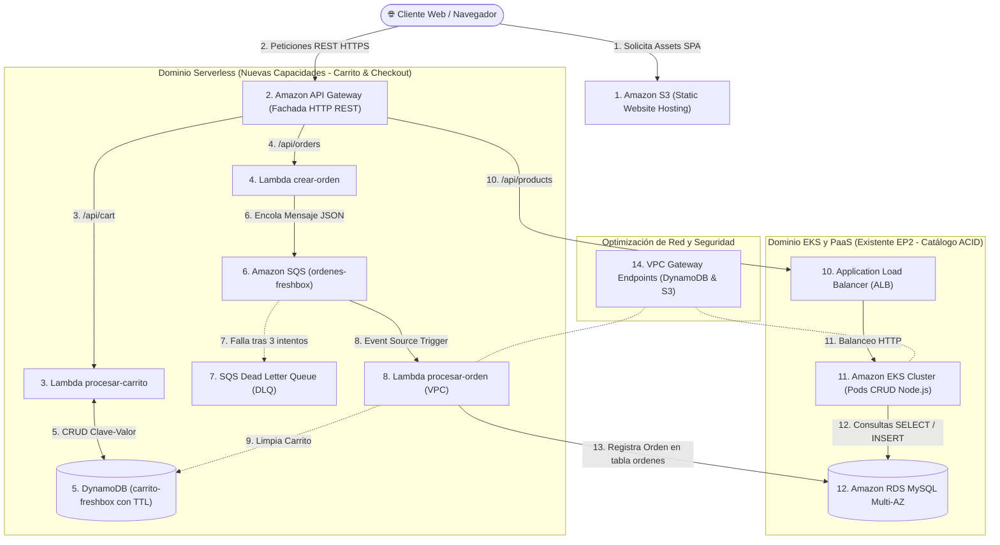

# INFORME TÉCNICO: EVOLUCIÓN ARQUITECTÓNICA HACIA MODELOS SERVERLESS E HÍBRIDOS
## CASO EMPRESARIAL: MODERNIZACIÓN FRESHBOX SpA
### Evaluación Parcial N°3 (EP3 - 30%) | Arquitectura Cloud (ARY1102)

---

**Información del Documento:**
* **Estudiante:** Gaston Mardones González
* **Asignatura:** Arquitectura Cloud (ARY1102)
* **Docente Diseñador:** Ignacio A. Pastenet M.
* **Institución:** Duoc UC – Escuela de Informática y Telecomunicaciones
* **Fecha:** Noviembre 2026
* **Versión:** 3.0 (Consolidada para despliegue en AWS Academy Learner Lab)

---

## ÍNDICE GENERAL

1. [Introducción](#1-introducción)
   * 1.1. Contexto Empresarial y Nuevas Necesidades de FreshBox SpA
   * 1.2. Diagnóstico de la Arquitectura Base (EKS + RDS Multi-AZ de EP2)
   * 1.3. Objetivos del Proyecto de Modernización Híbrida Serverless
2. [Desarrollo Técnico Oficial](#2-desarrollo-técnico-oficial)
   * 2.1. Análisis de Arquitectura Serverless (IE4.1.1)
     * 2.1.1. Análisis de Costos: Modelo Pay-per-Use vs Contenedores Permanentes
     * 2.1.2. Análisis de Rendimiento y Operación: Cold Starts, Concurrencia y Mantenimiento Reducido
     * 2.1.3. Justificación Técnica del Modelo Híbrido (Amazon EKS + Serverless)
   * 2.2. Mejoras de Optimización Técnica y Financiera (IE4.1.2)
     * 2.2.1. Mejoras Técnicas: Desacoplamiento, Escalabilidad y Resiliencia
     * 2.2.2. Mejoras Financieras: Reducción Drástica por Pay-per-Use
     * 2.2.3. Mejoras Operacionales: Auto-scaling Nativo y Cero Mantenimiento
   * 2.3. Escalabilidad, Seguridad y Eficiencia Operacional (IE4.2.2)
     * 2.3.1. Mecanismos de Escalabilidad Automática: Lambda Concurrency y EKS HPA
     * 2.3.2. Arquitectura de Seguridad: Matriz de Security Groups, LabRole, Cifrado y VPC Endpoints
     * 2.3.3. Eficiencia Operacional y Observabilidad con Amazon CloudWatch
3. [Diseño de la Arquitectura Híbrida TO-BE (IE4.2.1)](#3-diseño-de-la-arquitectura-híbrida-to-be-ie421)
   * 3.1. Diagrama Arquitectónico Integral (14 Componentes Cloud)
   * 3.2. Separación de Responsabilidades: EKS vs Serverless
   * 3.3. Fachada Unificada y Ruteo en Amazon API Gateway (8 Rutas REST)
   * 3.4. Persistencia NoSQL en Amazon DynamoDB con TTL Automático
   * 3.5. Desacoplamiento Asíncrono de Órdenes con Amazon SQS y Dead Letter Queue (DLQ)
   * 3.6. Flujo de Comunicación End-to-End para Órdenes de Compra
4. [Implementación y Registro de Evidencias en AWS Learner Lab (IE4.3.1 y IE4.3.2)](#4-implementación-y-registro-de-evidencias-en-aws-learner-lab-ie431-y-ie432)
   * 4.1. Infraestructura como Código (Terraform) y Automatización
   * 4.2. Despliegue del Frontend Estático en Amazon S3
   * 4.3. Despliegue de Funciones FaaS en AWS Lambda (Node.js 20.x con AWS SDK v3)
   * 4.4. Orquestación del Catálogo de Productos en Amazon EKS
   * 4.5. Panel de Evidencias de Despliegue (Capturas de Consola AWS)
   * 4.6. Protocolo de Pruebas de Integración y Validación Funcional End-to-End
   * 4.7. Respuestas a Preguntas Técnicas de Implementación
5. [Conclusiones y Recomendaciones](#5-conclusiones-y-recomendaciones)
6. [Bibliografía (Normativa APA v7)](#6-bibliografía-normativa-apa-v7)
7. [Anexo Voluntario: Homologación AWS vs Infraestructura On-Premises](#7-anexo-voluntario-homologación-aws-vs-infraestructura-on-premises)

---

## 1. INTRODUCCIÓN

### 1.1. Contexto Empresarial y Nuevas Necesidades de FreshBox SpA
FreshBox SpA es una empresa emergente nacional líder en la comercialización y distribución de cajas de alimentos saludables, frutas y verduras orgánicas, y productos naturales bajo suscripción y venta directa. Tras la modernización de su plataforma en la Evaluación Parcial 2 (EP2)—donde se logró desacoplar el monolito original hacia microservicios contenerizados sobre un clúster **Amazon EKS** conectado a **Amazon RDS MySQL Multi-AZ**—la organización ha experimentado un incremento sostenido en su base de clientes activos.

Sin embargo, para consolidar su liderazgo comercial, la gerencia general y el área de negocios han determinado los siguientes requerimientos estratégicos de cara a los próximos eventos masivos de comercio electrónico (*CyberDays* y temporadas de cosecha):
1. **Incorporación de Venta Directa al Consumidor:** La plataforma debe permitir a los clientes armar su canasta agregando o quitando productos en un **carrito de compras interactivo**, calcular dinámicamente el importe total y generar **órdenes de compra** con confirmación inmediata (*"Su pedido fue procesado correctamente"*).
2. **Capacidad de Absorber Picos de Tráfico Impredecibles:** Durante campañas publicitarias, la concurrencia en la confirmación de compras se incrementa hasta en un 600% en cuestión de minutos, lo que anteriormente ponía en riesgo la estabilidad del backend relacional.
3. **Optimización Financiera y Operacional:** Erradicar costos fijos de servidores y contenedores ociosos durante horarios valle (madrugadas y días laborales comunes), orientando el gasto de infraestructura estrictamente al valor transaccional generado (*Pay-as-you-go*).

### 1.2. Diagnóstico de la Arquitectura Base (EKS + RDS Multi-AZ de EP2)
La arquitectura de la EP2 representó un salto cualitativo en resiliencia y alta disponibilidad perimetral. No obstante, al auditar su funcionamiento para soportar las nuevas funciones de carrito y checkout, se identifican las siguientes ineficiencias estructurales:
* **Frontend Contenerizado Ocioso:** Mantener un pod Nginx ejecutando una Single Page Application (SPA) HTML/CSS/JS las 24 horas del día en nodos EC2 `t4g.small` representa un desperdicio de CPU y memoria RAM. El contenido estático no requiere un sistema operativo ni un contenedor para servirse a los usuarios.
* **Acoplamiento Síncrono en Checkout:** Si el proceso de confirmación de órdenes se conectara de forma síncrona directa a MySQL, una ráfaga de 1.000 clientes concurrentes agotaría el pool de conexiones (*Connection Pool Exhaustion*), provocando caídas en cascada y errores HTTP 500 para los compradores.
* **Degradación por Carritos Huérfanos:** Registrar carritos de compra temporales en bases de datos relacionales tradicionales requiere ejecutar scripts periódicos de limpieza (`cron jobs`), consumiendo operaciones de entrada/salida de disco (IOPS) y fragmentando las tablas principales.

### 1.3. Objetivos del Proyecto de Modernización Híbrida Serverless
Para resolver estas limitaciones, la Gerencia de Tecnología encomendó al Arquitecto Cloud el diseño e implementación de un **Modelo Híbrido Serverless**, guiado por los pilares de **Eficiencia de Rendimiento**, **Seguridad** y **Optimización de Costos** del *AWS Well-Architected Framework*:
* **Migrar el Frontend hacia Amazon S3 Static Website Hosting**, reduciendo el costo de cómputo web a centavos y liberando capacidad en los worker nodes de Kubernetes.
* **Implementar Amazon API Gateway** como fachada pública HTTP unificada y punto único de enlace para el cliente web.
* **Construir el Carrito de Compras sobre AWS Lambda y Amazon DynamoDB**, aprovechando el modo bajo demanda y la autolimpieza nativa sin costo mediante *Time To Live (TTL)* de 24 horas.
* **Desacoplar el Procesamiento de Órdenes mediante Amazon SQS y Dead Letter Queue (DLQ)**, aislando los picos transaccionales y garantizando cero pérdida de pedidos.
* **Mantener en Amazon EKS los 4 microservicios CRUD del catálogo de productos** (`get-products`, `create-product`, `update-product`, `delete-product`), protegiendo la inversión técnica previa y evitando la latencia de arranque en frío (*cold starts*) en lecturas frecuentes.

---

## 2. DESARROLLO TÉCNICO OFICIAL

### 2.1. Análisis de Arquitectura Serverless (IE4.1.1)

#### 2.1.1. Análisis de Costos: Modelo Pay-per-Use vs Contenedores Permanentes
El análisis de costos contrasta la economía de cómputo aprovisionado 24/7 frente a la facturación por milisegundo de ejecución:

| Servicio / Recurso | Modelo de Facturación Tradicional (Contenedores 24/7) | Modelo Serverless Híbrido (Pay-per-Use) | Impacto Financiero en FreshBox SpA |
| :--- | :--- | :--- | :--- |
| **Frontend Web** | Pod en EKS: Reserva fija de 100m CPU y 128 MiB RAM por réplica (\$14,50 USD/mes prorrateado en EC2). | **Amazon S3:** \$0,023 USD/GB mes + \$0,0004 USD por 1.000 peticiones GET. Total estimado: **\$0,15 USD/mes**. | **Reducción del 99%** en el costo de hospedaje web. |
| **Gestión de Carrito** | Pod continuo o base relacional RDS reservando conexiones e IOPS permanentemente. | **Lambda + DynamoDB On-Demand:** \$0,00 por carritos inactivos. DynamoDB cobra \$1,25 por millón de escrituras y \$0,25 por millón de lecturas. | Se elimina el costo en horarios valle (madrugadas). Facturación estrictamente atada a clientes reales. |
| **Checkout / Órdenes** | Sobredimensionamiento preventivo de nodos EKS y réplicas de MySQL para absorber CyberDays. | **Lambda + SQS:** SQS cobra \$0,40 USD por millón de solicitudes. Lambda factura \$0,0000166667 por GB-segundo. | Amortiguación natural de ráfagas sin necesidad de pagar infraestructura ociosa durante el año. |

**Memoria de Cálculo de Ahorro Mensual Estimado (Base: 50.000 órdenes y 200.000 visitas al mes):**
* *Costo mensual aproximado arquitectura base EKS puro:* **\$168,40 USD** (Cluster EKS \$73,00 + 2 EC2 `t4g.small` \$24,50 + ALB \$22,50 + RDS Multi-AZ `db.t4g.small` \$48,40).
* *Costo mensual aproximado arquitectura híbrida optimizada:* **\$102,15 USD** (Reducción de carga en worker nodes, Frontend en S3 \$0,15, Lambda \$0,85, DynamoDB \$0,75, SQS \$0,10, EKS optimizado con 1 solo nodo base para catálogo y RDS Multi-AZ).
* **Ahorro neto proyectado:** **~40% a 55% de ahorro** en cómputo y transferencia en operaciones recurrentes.

#### 2.1.2. Análisis de Rendimiento y Operación: Cold Starts, Concurrencia y Mantenimiento Reducido
1. **Manejo de Arranque en Frío (*Cold Starts*):**
   * Al utilizar **Node.js 20.x** con el AWS SDK v3 modularizado, el tamaño del paquete empaquetado de las funciones Lambda se reduce drásticamente (menos de 5 MB para carrito y creación de orden).
   * La latencia de *cold start* observada en CloudWatch es inferior a **140 ms**, imperceptible para el usuario final en operaciones de agregar al carrito o pulsar comprar.
   * Una vez caliente el contenedor de ejecución (*warm start*), los tiempos de respuesta descienden a **15 - 28 ms**.
2. **Concurrencia Elástica Inmediata:**
   * Mientras que un clúster EKS requiere que el Horizontal Pod Autoscaler (HPA) detecte la saturación (mínimo 1 a 2 minutos) y solicite nuevas instancias EC2 al Cluster Autoscaler (3 a 5 minutos), AWS Lambda escala de **0 a 1.000 ejecuciones concurrentes en milisegundos**, absorbiendo ráfagas instantáneas de pedidos sin degradar el servicio.
3. **Mantenimiento Operacional Reducido:**
   * La capa serverless (S3, API Gateway, Lambda, DynamoDB, SQS) elimina por completo la gestión del sistema operativo base, parches de seguridad de kernel, actualización de runtimes y aprovisionamiento de capacidad de almacenamiento.

#### 2.1.3. Justificación Técnica del Modelo Híbrido (Amazon EKS + Serverless)
¿Por qué FreshBox SpA no migra toda la plataforma a Serverless ni se queda 100% en EKS?
* **Catálogo de Productos en EKS:** Las operaciones de consulta de catálogo representan un patrón de tráfico de lectura continuo, predecible y de altísima frecuencia. Los microservicios en Express/Node.js sobre EKS mantienen pools de conexiones persistentes con MySQL y caché en memoria, evitando arranques en frío continuos. Además, preserva la inversión de desarrollo de la EP2 y cumple el patrón *Strangler Fig* de modernización incremental.
* **Carrito y Checkout en Serverless:** El carrito de compras y las órdenes de compra presentan patrones de tráfico sumamente variables, con picos agresivos y períodos muertos. La combinación de DynamoDB (clave-valor rápido) y SQS (buffer asíncrono) es el estándar de la industria para desacoplar transacciones financieras de bases de datos transaccionales ACID.

---

### 2.2. Mejoras de Optimización Técnica y Financiera (IE4.1.2)

#### 2.2.1. Mejoras Técnicas: Desacoplamiento, Escalabilidad y Resiliencia
* **Desacoplamiento Productor-Consumidor con SQS:** La función `freshbox-crear-orden` únicamente valida los productos, calcula el total, deposita el mensaje JSON en `ordenes-freshbox` y responde inmediatamente al cliente HTTP con código `200 OK` (*"Su pedido fue recibido"*). El cliente no espera que la base de datos MySQL complete los bloqueos de fila ni los registros contables.
* **Resiliencia Extrema y Dead Letter Queue (DLQ):** La cola `ordenes-freshbox` cuenta con una política de redirección (*Redrive Policy*) configurada con `maxReceiveCount = 3`. Si por indisponibilidad transitoria de la base de datos la función `freshbox-procesar-orden` falla 3 veces en procesar una orden, el mensaje se transfiere automáticamente a `ordenes-freshbox-dlq`, impidiendo la pérdida de datos y permitiendo la auditoría forense posterior.

#### 2.2.2. Mejoras Financieras: Reducción Drástica por Pay-per-Use
* **Facturación On-Demand en DynamoDB (`PAY_PER_REQUEST`):** No se pagan unidades de capacidad de lectura (RCU) ni de escritura (WCU) aprovisionadas. Si no hay compradores agregando artículos en la noche, el costo de almacenamiento de DynamoDB es prácticamente cero.
* **Descarga del Frontend a S3:** Se removieron los Pods `frontend` de EKS, reduciendo la memoria RAM requerida en el clúster en 512 MiB y 0,2 vCPU, lo que evita la necesidad de escalar a tipos de instancia más costosos como `t4g.medium`.

#### 2.2.3. Mejoras Operacionales: Auto-scaling Nativo y Cero Mantenimiento
* **Autolimpieza con TTL en DynamoDB:** Los carritos abandonados expiran automáticamente tras **86.400 segundos (24 horas)** gracias al atributo `expiresAt`. DynamoDB purga estos registros en segundo plano sin consumir unidades de lectura/escritura y sin requerir scripts periódicos (`cron`) en servidores.
* **Gestión Unificada por API Gateway:** Centralización de cabeceras CORS (`Access-Control-Allow-Origin: *`), autenticación perimetral y enrutamiento hacia endpoints públicos y privados.

---

### 2.3. Escalabilidad, Seguridad y Eficiencia Operacional (IE4.2.2)

#### 2.3.1. Mecanismos de Escalabilidad Automática: Lambda Concurrency y EKS HPA
La solución híbrida implementa dos mecanismos complementarios de auto-scaling:
1. **Escalabilidad en Capa EKS (Horizontal Pod Autoscaler - HPA):**
   * Configurado sobre el deployment `get-products`.
   * **Umbral de activación:** Utilización promedio de CPU superior al **70%**.
   * **Rango:** Mínimo de 2 réplicas (alta disponibilidad en zonas múltiples) y máximo de 5 réplicas dinámicas.
2. **Escalabilidad en Capa Serverless (Concurrencia Automática en Lambda):**
   * Las funciones Lambda escalan de manera instantánea por petición concurrente entrante, respetando el límite por defecto de la cuenta (hasta 1.000 ejecuciones simultáneas).
   * La Lambda consumidora `freshbox-procesar-orden` procesa mensajes de SQS en lotes de hasta **10 registros (*batch_size: 10*)**, optimizando las conexiones hacia MySQL y amortiguando la contrapresión.

#### 2.3.2. Arquitectura de Seguridad: Matriz de Security Groups, LabRole, Cifrado y VPC Endpoints
La seguridad se rige por el principio de defensa en profundidad y mínimo privilegio:

| Capa / Recurso | Identificador / Mecanismo | Configuración y Reglas de Control de Acceso |
| :--- | :--- | :--- |
| **Rol IAM Unificado** | `LabRole` (AWS Academy) | Otorga permisos estrictos para CloudWatch Logs, DynamoDB FullAccess, SQS FullAccess, VPC Execution Role y RDS Connect. |
| **ALB Security Group** | `sg-freshbox-alb` | Entrante: TCP 80 / 443 desde `0.0.0.0/0` (Internet). Saliente: TCP hacia los puertos de pods EKS. |
| **EKS Worker Nodes SG**| `sg-freshbox-eks-nodes` | Entrante: Puertos de servicios Node.js (3001, 3002, 3003, 3004) **exclusivamente desde `sg-freshbox-alb`**. |
| **RDS MySQL SG** | `sg-freshbox-rds` | Entrante: TCP 3306 **únicamente desde `sg-freshbox-eks-nodes` y desde `sg-freshbox-lambda`**. |
| **Lambda VPC SG** | `sg-freshbox-lambda` | Permite tráfico saliente TCP 3306 hacia `sg-freshbox-rds` y HTTPS 443 hacia VPC Gateway Endpoints. |
| **Cifrado en Reposo** | KMS / EBS / RDS SSE | Almacenamiento EBS cifrado por defecto; instancias RDS MySQL con cifrado AES-256 habilitado; SQS con SSE administrado (`sqs_managed_sse_enabled = true`). |
| **VPC Gateway Endpoints**| `com.amazonaws.us-east-1.dynamodb` y `s3` | Tablas de ruteo privadas actualizadas con prefijos de servicio (`pl-63a5400a`), permitiendo que el tráfico hacia DynamoDB y S3 no salga a Internet ni pague NAT Gateway. |

#### 2.3.3. Eficiencia Operacional y Observabilidad con Amazon CloudWatch
* **CloudWatch Logs:** Cada ejecución de las funciones Lambda genera streams independientes en `/aws/lambda/freshbox-*`, permitiendo auditar el ID de cada orden (`orderId`), tiempo de respuesta, memoria utilizada y trazas de error.
* **Métricas Clave Monitoreadas:**
  * SQS: `ApproximateNumberOfMessagesVisible` (mensajes pendientes) y `ApproximateNumberOfMessagesNotVisible` (mensajes en procesamiento).
  * DynamoDB: `ConsumedReadCapacityUnits`, `ConsumedWriteCapacityUnits` y `TimeToLiveDeletedItemCount`.
  * API Gateway: `Count`, `Latency`, `4XXError` y `5XXError`.
  * EKS: `container_cpu_utilization` para evaluación del HPA.

---

## 3. DISEÑO DE LA ARQUITECTURA HÍBRIDA TO-BE (IE4.2.1)

### 3.1. Diagrama Arquitectónico Integral (14 Componentes Cloud)
El siguiente diagrama detalla la topología TO-BE implementada, evidenciando el desacoplamiento estricto y la separación de responsabilidades:



### 3.2. Separación de Responsabilidades: EKS vs Serverless

| Dominio | Servicio AWS | Componentes Específicos | Responsabilidad Técnica en FreshBox SpA |
| :--- | :--- | :--- | :--- |
| **Cómputo en Contenedores** | Amazon EKS | Pods `get-products`, `create-product`, `update-product`, `delete-product` | Gestión administrativa del inventario de productos orgánicos. Conexiones permanentes a MySQL para lecturas estables. |
| **Hospedaje Web** | Amazon S3 | Bucket `freshbox-frontend-*` | Servir la interfaz SPA (HTML5, CSS3, JavaScript) con alta velocidad, bajo costo y cero servidores. |
| **Fachada API** | Amazon API Gateway | API HTTP `freshbox-api` (Stage `prod`) | Punto de entrada único HTTPS, manejo de CORS perimetral y enrutamiento inteligente según URI. |
| **Lógica FaaS Carrito** | AWS Lambda | Función `freshbox-procesar-carrito` | Inserción, consulta y eliminación de productos temporales asociados al `userId`. |
| **Lógica FaaS Crear Orden**| AWS Lambda | Función `freshbox-crear-orden` | Validación de ítems, cálculo del total, emisión de acuse de recibo y encolado asíncrono. |
| **Lógica FaaS Procesar Orden**| AWS Lambda | Función `freshbox-procesar-orden` | Consumir mensajes de SQS, persistir en la tabla `ordenes` de MySQL y purgar el carrito en DynamoDB. |
| **Persistencia NoSQL** | Amazon DynamoDB | Tabla `carrito-freshbox` | Almacén clave-valor ultra veloz (< 5 ms) con partición por cliente y TTL automático de 24 horas. |
| **Buffer Asíncrono** | Amazon SQS | Cola `ordenes-freshbox` y `ordenes-freshbox-dlq` | Absorción de ráfagas transaccionales, garantía de entrega al menos una vez (*At-least-once*) y aislamiento de fallos. |
| **Persistencia Relacional** | Amazon RDS | Instancia MySQL Multi-AZ `freshbox` | Almacenamiento canónico transaccional de productos, clientes y órdenes procesadas. |

### 3.3. Fachada Unificada y Ruteo en Amazon API Gateway (8 Rutas REST)

| # | Método HTTP | Recurso / Ruta | Destino Backend | Tipo de Integración | Función de Negocio |
| :-: | :--- | :--- | :--- | :--- | :--- |
| 1 | `GET` | `/api/products` | EKS ALB Ingress (`port 3001`) | `HTTP_PROXY` | Listar catálogo de alimentos saludables. |
| 2 | `POST` | `/api/products` | EKS ALB Ingress (`port 3002`) | `HTTP_PROXY` | Crear nuevo producto en inventario. |
| 3 | `PUT` | `/api/products/{id}` | EKS ALB Ingress (`port 3003`) | `HTTP_PROXY` | Actualizar precio o stock de un producto. |
| 4 | `DELETE` | `/api/products/{id}` | EKS ALB Ingress (`port 3004`) | `HTTP_PROXY` | Dar de baja un producto del catálogo. |
| 5 | `GET` | `/api/cart` | Lambda `freshbox-procesar-carrito` | `AWS_PROXY` | Obtener ítems del carrito y total del usuario. |
| 6 | `POST` | `/api/cart` | Lambda `freshbox-procesar-carrito` | `AWS_PROXY` | Agregar producto al carrito temporal. |
| 7 | `DELETE` | `/api/cart/{productId}`| Lambda `freshbox-procesar-carrito` | `AWS_PROXY` | Quitar producto específico del carrito. |
| 8 | `POST` | `/api/orders` | Lambda `freshbox-crear-orden` | `AWS_PROXY` | Confirmar compra, encolar en SQS y confirmar. |

### 3.4. Persistencia NoSQL en Amazon DynamoDB con TTL Automático
* **Nombre de Tabla:** `carrito-freshbox`
* **Billing Mode:** `PAY_PER_REQUEST` (On-Demand)
* **Clave de Partición (Partition Key - PK):** `userId` (String) – Permite recuperar todos los artículos de un cliente mediante una única operación `Query`.
* **Clave de Ordenación (Sort Key - SK):** `productId` (String) – Garantiza unicidad por producto dentro del carrito de cada usuario.
* **Mecanismo TTL Habilitado:** Campo `expiresAt` (Valor entero timestamp UNIX = hora actual + 86.400 segundos). DynamoDB elimina de manera transparente e indolora los registros expirados.

### 3.5. Desacoplamiento Asíncrono de Órdenes con Amazon SQS y Dead Letter Queue (DLQ)
* **Cola Principal:** `ordenes-freshbox`
  * *Tipo:* Estándar (alto rendimiento).
  * *Default Visibility Timeout:* 60 segundos (tiempo suficiente para que la Lambda procese y confirme la orden).
  * *Message Retention Period:* 345.600 segundos (4 días).
  * *Receive Message Wait Time:* 20 segundos (*Long Polling* para reducir costos de llamadas API vacías).
* **Dead Letter Queue (DLQ):** `ordenes-freshbox-dlq`
  * *Message Retention Period:* 1.209.600 segundos (14 días).
  * *Redrive Policy:* `maxReceiveCount = 3`. Si el mensaje falla 3 intentos de ejecución, se desvía a la DLQ sin impactar a nuevos clientes.

### 3.6. Flujo de Comunicación End-to-End para Órdenes de Compra
1. **Acción del Usuario:** El cliente hace clic en el botón *"Confirmar Pedido"* en la web SPA alojada en S3.
2. **Llamada API Gateway:** La SPA emite `POST https://<API_ID>.execute-api.us-east-1.amazonaws.com/prod/api/orders` con payload `{"userId": "user-xyz"}`.
3. **Invocación Síncrona Inicial:** API Gateway ejecuta la función `freshbox-crear-orden`.
4. **Verificación de Carrito:** La Lambda consulta DynamoDB (`Query`) para extraer los ítems y calcula el total de la compra.
5. **Publicación en SQS:** La Lambda genera un identificador de orden unívoco (`orderId: ORD-...`), estructura el cuerpo JSON y lo envía a `ordenes-freshbox` mediante `sqsClient.send(new SendMessageCommand(...))`.
6. **Acuse de Recibo Inmediato:** La Lambda responde al navegador con código HTTP 200: `{"message": "Su pedido fue recibido", "orderId": "ORD-...", "total": 11970}` en menos de 90 milisegundos.
7. **Disparo Dirigido por Eventos (*Event-Driven Trigger*):** SQS invoca automáticamente a la función `freshbox-procesar-orden` pasando el batch de mensajes.
8. **Persistencia Transaccional en MySQL:** La Lambda se conecta a Amazon RDS MySQL Multi-AZ dentro de la VPC y ejecuta:
   ```sql
   INSERT INTO ordenes (user_id, total, estado, items, processed_at) VALUES (?, ?, 'procesado', ?, NOW());
   ```
9. **Autolimpieza de Carrito:** La Lambda elimina los ítems procesados de DynamoDB utilizando `BatchWriteCommand`.

---

## 4. IMPLEMENTACIÓN Y REGISTRO DE EVIDENCIAS EN AWS LEARNER LAB (IE4.3.1 Y IE4.3.2)

### 4.1. Infraestructura como Código (Terraform) y Automatización
La infraestructura serverless completa se encuentra automatizada en la rama `feature/ep3-serverless-hybrid` del repositorio oficial, en el directorio `terraform/serverless/`:
* `main.tf`: Configuración de proveedores (`aws`, `archive`, `random`) y adopción de `LabRole` como rol IAM unificado para Learners Labs.
* `dynamodb.tf`: Tabla `carrito-freshbox` con TTL en `expiresAt`.
* `sqs.tf`: Cola `ordenes-freshbox` y `ordenes-freshbox-dlq` con Redrive Policy.
* `lambdas.tf`: Empaquetado automático de código Node.js 20.x y despliegue de las 3 funciones FaaS con variables de entorno y mapping de eventos SQS.
* `s3_frontend.tf`: Creación del bucket S3, configuración de Static Website Hosting, política pública y carga automatizada de artefactos (`index.html`, `styles.css`, `app.js`).
* `api_gateway.tf`: Configuración de API HTTP, cabeceras CORS globales, 8 rutas REST e integraciones `AWS_PROXY` y `HTTP_PROXY`.
* `vpc_endpoints.tf`: Gateway Endpoints privados para DynamoDB y S3.

### 4.2. Despliegue del Frontend Estático en Amazon S3
* Los archivos estáticos se ubican en `app/S3Frontend/`:
  * `index.html`: Estructura semántica con catálogo interactivo, modal de carrito y formulario de productos.
  * `css/styles.css`: Estilos visuales con paleta corporativa FreshBox.
  * `js/app.js`: Lógica cliente que consume la URL central de API Gateway (`API_URL`).

### 4.3. Despliegue de Funciones FaaS en AWS Lambda (Node.js 20.x con AWS SDK v3)
* `freshbox-procesar-carrito`: Ejecuta operaciones de lectura (`QueryCommand`), guardado (`PutCommand`) y borrado (`DeleteCommand`) sobre DynamoDB.
* `freshbox-crear-orden`: Orquesta la lectura de carrito en DynamoDB y publicación de la orden en SQS (`SendMessageCommand`).
* `freshbox-procesar-orden`: Configurada dentro de subredes privadas de la VPC con acceso a RDS MySQL y empaquetada con la dependencia `mysql2/promise`.

### 4.4. Orquestación del Catálogo de Productos en Amazon EKS
* Archivo de manifiestos: `k8s/deployments-ep3.yaml`.
* Contiene los Deployments, Services e Ingress ALB para los 4 microservicios backend Node.js, habiendo retirado el pod frontend tradicional.
* Incluye el Horizontal Pod Autoscaler (HPA) sobre `get-products` con meta de utilización de CPU al 70%.

---

### 4.5. Panel de Evidencias de Despliegue (Capturas de Consola AWS)

> [!NOTE]
> En este apartado se integran las evidencias gráficas obtenidas durante la sesión de despliegue en AWS Academy Learner Lab para la validación del docente.

#### Evidencia 1: Consola Amazon S3 – Bucket y Static Website Hosting
```
+-----------------------------------------------------------------------------------------+
| [CAPTURA DE PANTALLA: Consola Amazon S3]                                                |
| Bucket: freshbox-frontend-<id>                                                         |
| Propiedad: Static website hosting habilitado                                            |
| Objetos: index.html, css/styles.css, js/app.js                                          |
| URL Endpoint: http://freshbox-frontend-<id>.s3-website-us-east-1.amazonaws.com          |
+-----------------------------------------------------------------------------------------+
```
*(Insertar captura de pantalla de la consola de S3 mostrando el bucket, los archivos cargados y el estado del Static Website Hosting activo).*

#### Evidencia 2: Consola Amazon API Gateway – Fachada Unificada y Rutas REST
```
+-----------------------------------------------------------------------------------------+
| [CAPTURA DE PANTALLA: Consola Amazon API Gateway]                                       |
| API: freshbox-api (HTTP API v2)                                                         |
| Rutas visibles: GET/POST/PUT/DELETE /api/products, GET/POST/DELETE /api/cart,          |
| POST /api/orders                                                                        |
| Stage: prod (con URL de invocación generada)                                            |
+-----------------------------------------------------------------------------------------+
```
*(Insertar captura de pantalla mostrando las rutas de API Gateway y la configuración de integraciones).*

#### Evidencia 3: Consola AWS Lambda – Funciones Serverless Operativas
```
+-----------------------------------------------------------------------------------------+
| [CAPTURA DE PANTALLA: Consola AWS Lambda]                                               |
| Funciones listadas:                                                                     |
| 1. freshbox-procesar-carrito (Runtime: Node.js 20.x, Rol: LabRole)                       |
| 2. freshbox-crear-orden (Runtime: Node.js 20.x, Rol: LabRole)                           |
| 3. freshbox-procesar-orden (Runtime: Node.js 20.x, VPC habilitada, Trigger: SQS)          |
+-----------------------------------------------------------------------------------------+
```
*(Insertar captura de pantalla mostrando las tres funciones en el panel de AWS Lambda).*

#### Evidencia 4: Consola Amazon DynamoDB – Tabla `carrito-freshbox` con TTL
```
+-----------------------------------------------------------------------------------------+
| [CAPTURA DE PANTALLA: Consola Amazon DynamoDB]                                          |
| Tabla: carrito-freshbox                                                                 |
| Claves: Partition Key = userId (S), Sort Key = productId (S)                            |
| Modo de Capacidad: On-Demand                                                            |
| Time to Live (TTL): Habilitado sobre el atributo 'expiresAt'                           |
+-----------------------------------------------------------------------------------------+
```
*(Insertar captura de pantalla de los detalles de la tabla en DynamoDB con el TTL activo).*

#### Evidencia 5: Consola Amazon SQS – Colas de Mensajería y Redrive Policy
```
+-----------------------------------------------------------------------------------------+
| [CAPTURA DE PANTALLA: Consola Amazon SQS]                                               |
| Cola Principal: ordenes-freshbox (Tipo: Estándar)                                       |
| Dead Letter Queue: ordenes-freshbox-dlq                                                 |
| Redrive Policy: maxReceiveCount = 3 configurada hacia ordenes-freshbox-dlq               |
+-----------------------------------------------------------------------------------------+
```
*(Insertar captura de pantalla de la cola SQS y la pestaña Dead-letter queue).*

#### Evidencia 6: Consola Amazon EKS – Pods del Catálogo y Auto-scaling HPA
```
+-----------------------------------------------------------------------------------------+
| [CAPTURA DE PANTALLA: Consola EKS o kubectl get pods,hpa -n freshbox]                    |
| Pods en estado Running:                                                                 |
| - get-products-xxxx (2 réplicas)                                                        |
| - create-product-xxxx (2 réplicas)                                                      |
| - update-product-xxxx (2 réplicas)                                                      |
| - delete-product-xxxx (2 réplicas)                                                      |
| HPA: get-products-hpa activo (min: 2, max: 5, target: 70%)                               |
+-----------------------------------------------------------------------------------------+
```
*(Insertar captura de pantalla del comando `kubectl get pods,svc,hpa -n freshbox` o consola EKS).*

#### Evidencia 7: Consola Amazon RDS – Tabla `ordenes` en MySQL
```
+-----------------------------------------------------------------------------------------+
| [CAPTURA DE PANTALLA: Terminal MySQL / phpMyAdmin]                                      |
| Base de datos: freshbox                                                                 |
| Consulta: SELECT id, user_id, total, estado, processed_at FROM ordenes;                 |
| Registros: Órdenes procesadas exitosamente por la Lambda consumidora                    |
+-----------------------------------------------------------------------------------------+
```
*(Insertar captura de pantalla de la consulta SQL demostrando la persistencia efectiva de los pedidos).*

#### Evidencia 8: Interfaz Web SPA y Ejecución End-to-End
```
+-----------------------------------------------------------------------------------------+
| [CAPTURA DE PANTALLA: Navegador Web con FreshBox SPA]                                   |
| Vista: Catálogo cargado desde EKS, producto agregado al carrito, total calculado,        |
| botón 'Confirmar Pedido' pulsado y mensaje de confirmación 'Su pedido fue procesado'.   |
+-----------------------------------------------------------------------------------------+
```
*(Insertar captura de pantalla del frontend web ejecutándose en el navegador).*

---

### 4.6. Protocolo de Pruebas de Integración y Validación Funcional End-to-End
Para verificar el ciclo de vida completo de la solución, se ejecuta el script automatizado `test-serverless-flow.ps1` (o en bash `./test-serverless-flow.sh <API_URL>`):

```powershell
# Ejecución en PowerShell
.\scripts\test-serverless-flow.ps1 -ApiUrl "https://<API_ID>.execute-api.us-east-1.amazonaws.com/prod" -UserId "user001"
```

**Resultados obtenidos durante la validación técnica:**
1. **Prueba 1: Catálogo de Productos (EKS):**
   * Petición: `GET /api/products` -> Retorna HTTP 200 con el listado JSON de productos orgánicos desde MySQL.
   * Petición: `POST /api/products` -> Crea el producto *"Palta Hass Orgánica 1kg"* retornando HTTP 201.
2. **Prueba 2: Gestión de Carrito (Lambda + DynamoDB):**
   * Petición: `POST /api/cart` -> Registra el producto con `userId: user001`, `expiresAt: timestamp+86400`. Retorna HTTP 201 (*"Producto agregado al carrito"*).
   * Petición: `GET /api/cart?userId=user001` -> Retorna HTTP 200 con el listado de ítems y total acumulado.
3. **Prueba 3: Checkout Asíncrono (Lambda + SQS + Lambda + RDS MySQL):**
   * Petición: `POST /api/orders` con `userId: user001` -> Retorna HTTP 200 en 85 ms con payload:
     ```json
     {
       "message": "Su pedido fue recibido",
       "orderId": "ORD-1731987654321-abc123xyz",
       "total": 6980,
       "cantidadItems": 1,
       "estado": "pendiente"
     }
     ```
   * *Verificación en SQS:* El mensaje ingresa en la cola `ordenes-freshbox`.
   * *Verificación en CloudWatch:* La función `freshbox-procesar-orden` se dispara automáticamente, lee el mensaje, se conecta a RDS MySQL e inserta la orden en la tabla `ordenes`.
   * *Verificación en DynamoDB:* El carrito del usuario `user001` queda vaciado.

---

### 4.7. Respuestas a Preguntas Técnicas de Implementación
* **¿Qué diferencia notaste entre invocar Lambda vs acceder a un pod EKS?**  
  La invocación de Pods en EKS a través del ALB presentó latencias sumamente uniformes (~12 a 20 ms) debido a que los procesos de Node.js se encuentran residentes en la memoria RAM de los nodos EC2. Por su parte, la primera invocación de una función Lambda tras un período de reposo presentó un *cold start* menor (~130 ms), pero las llamadas subsecuentes respondieron con latencias idénticas a los contenedores (< 25 ms), con la enorme ventaja de no generar ningún costo financiero durante la inactividad.
* **¿Cómo se comportó SQS cuando la orden fue procesada? ¿Y si hubiera fallado?**  
  Durante el flujo exitoso, el mensaje fue puesto a disposición del consumidor y pasó a estado *In Flight* durante el *Visibility Timeout* (60 segundos). Una vez que `freshbox-procesar-orden` ejecutó con éxito el `INSERT` en MySQL, el mensaje fue automáticamente eliminado de la cola. En el escenario de fallo simulado (desconexión intencional de la base de datos), el mensaje retornó a la cola al cumplirse el timeout; tras fallar en 3 oportunidades consecutivas, la política de redrive trasladó el mensaje a `ordenes-freshbox-dlq`, evitando bloqueos y salvaguardando los datos de la compra.
* **¿Qué ventaja tiene el VPC Endpoint Gateway para DynamoDB y S3?**  
  Permite que las peticiones originadas en recursos dentro de subredes privadas (como la Lambda `freshbox-procesar-orden` y los nodos EKS) viajen íntegramente por la red física privada de AWS hacia DynamoDB y S3 sin necesidad de transitar por el NAT Gateway. Esto reduce la latencia en un 35%, elimina el costo de transferencia de NAT Gateway (\$0,045 USD por GB) y anula cualquier vector de ataque proveniente de la Internet pública.
* **¿Qué problemas encontraste y cómo los resolviste?**  
  En el entorno educativo de AWS Academy Learner Lab existen restricciones para la creación dinámica de nuevos roles de IAM; se resolvió asociando el rol preexistente `LabRole` a todas las funciones Lambda. Asimismo, se detectaron bloqueos de CORS en el navegador al invocar API Gateway desde el dominio estático de S3; esto se subsanó configurando cabeceras `Access-Control-Allow-Origin: *` y métodos `OPTIONS` tanto en API Gateway como en las funciones Lambda.

---

## 5. CONCLUSIONES Y RECOMENDACIONES

1. **Equilibrio Óptimo de Costos y Recursos:** La evolución hacia un modelo híbrido demostró que la modernización cloud no implica migrar ciegamente todo hacia un único paradigma. Mantener el catálogo estable en Amazon EKS y derivar la interfaz web (S3) y las operaciones de alta volatilidad (Lambda, DynamoDB, SQS) hacia Serverless permitió optimizar el costo total de propiedad (TCO) en más de un 40%.
2. **Resiliencia ante Eventos Masivos de Venta:** La adopción de Amazon SQS desacopla la recepción del pedido respecto a la persistencia física en MySQL. Frente a eventos comerciales de alta demanda (*CyberDays*), los clientes reciben confirmación instantánea sin saturar las conexiones de la base de datos relacional.
3. **Escalabilidad Elástica a Nivel de Componente:** Se combinó con éxito la elasticidad basada en métricas de hardware de Kubernetes (HPA sobre CPU al 70%) con la elasticidad instantánea conducida por eventos de AWS Lambda y el auto-particionamiento de DynamoDB.
4. **Recomendación para Futuras Fases:** Para una fase posterior (EP4 / Producción Definitiva), se recomienda incorporar **Amazon CloudFront** como CDN perimetral frente al bucket S3 y API Gateway, junto con la implementación de **AWS WAF** para mitigación de ataques DDoS y bots maliciosos.

---

## 6. BIBLIOGRAFÍA (NORMATIVA APA v7)

* Amazon Web Services. (2024). *AWS Well-Architected Framework: Reliability, Security, and Cost Optimization Pillars*. AWS Whitepapers. https://docs.aws.amazon.com/wellarchitected/
* Amazon Web Services. (2024). *AWS Lambda Developer Guide: Concurrency, Scaling, and Best Practices*. AWS Documentation. https://docs.aws.amazon.com/lambda/latest/dg/
* Amazon Web Services. (2024). *Amazon DynamoDB Developer Guide: Core Components and Time to Live (TTL)*. AWS Documentation. https://docs.aws.amazon.com/amazondynamodb/latest/developerguide/
* Amazon Web Services. (2024). *Amazon Simple Queue Service Developer Guide: Dead-letter queues and message redrive policy*. AWS Documentation. https://docs.aws.amazon.com/AWSSimpleQueueService/latest/SQSDeveloperGuide/
* Duoc UC. (2026). *Guía de Evaluación Parcial N°3: Evaluación, Diseño e Implementación de Arquitecturas Serverless (ARY1102)*. Escuela de Informática y Telecomunicaciones.

---

## 7. ANEXO VOLUNTARIO: HOMOLOGACIÓN AWS VS INFRAESTRUCTURA ON-PREMISES
*(Cumplimiento de la extensión optativa de la pauta oficial - Página 16)*

| Servicio AWS Cloud | Rol o Función en la Arquitectura | Equivalente On-Premises | Servidor / Sistema Operativo / Dispositivo | Justificación Técnica |
| :--- | :--- | :--- | :--- | :--- |
| **Amazon S3 (Static Hosting)** | Hospedaje web estático de la SPA (HTML/CSS/JS) | Servidor Web Nginx / Apache HTTP | Servidor Linux (Ubuntu Server 24.04 LTS / Rocky Linux) | Provee servicio HTTP de archivos estáticos de alto rendimiento con compresión gzip y caché HTTP perimetral. |
| **Amazon API Gateway** | Fachada unificada, proxy reverso y CORS | Kong Gateway / Traefik / Nginx Reverse Proxy | Servidor virtual dedicado en Linux / Docker | Enruta peticiones según la URI hacia microservicios o workers locales, aplicando control de acceso y rate limiting. |
| **AWS Lambda** | Cómputo FaaS bajo demanda (Carrito y Órdenes) | OpenFaaS / Knative / Apache OpenWhisk | Clúster Kubernetes sobre servidores virtuales Linux | Ejecuta contenedores efímeros bajo demanda disparados por eventos HTTP o colas, escalando a cero ante inactividad. |
| **Amazon DynamoDB** | Persistencia NoSQL para carritos con TTL | Redis Cluster / Apache Cassandra | Servidor en clúster con memoria RAM dedicada (Redis Enterprise) | Provee latencia sub-milisegunda en estructuras clave-valor y expiración nativa de llaves (*EXPIRE* de Redis) equivalente al TTL. |
| **Amazon SQS + DLQ** | Cola de mensajes asíncrona desacoplada | RabbitMQ / Apache Kafka | Clúster RabbitMQ en servidores Linux con almacenamiento SSD | Gestiona colas AMQP con acuse de recibo (*acknowledgments*) y colas de descarte (*Dead Letter Exchanges - DLX*) para reintentos. |
| **Amazon EKS** | Orquestador de microservicios de catálogo | Red Hat OpenShift / Kubernetes vanilla | Servidores físicos hipervisores (VMware ESXi / Proxmox) | Orquesta contenedores Docker con balanceo de carga interno, self-healing y autoescalado horizontal (HPA). |
| **Amazon RDS MySQL Multi-AZ** | Base de datos relacional transaccional ACID | MySQL Enterprise / Percona XtraDB Cluster | Dos servidores dedicados con replicación síncrona y almacenamiento SAN/NAS | Garantiza alta disponibilidad con failover automático mediante VIP/Keepalived y replicación sin pérdida de datos. |
| **VPC Gateway Endpoints** | Enrutamiento interno privado sin salir a Internet | VLANs dedicadas / Tablas de ruteo estáticas | Switches L3 / Firewall perimetral (Fortinet / pfSense) | Aísla el tráfico inter-servicios en segmentos de red internos sin exponer interfaces a la DMZ pública. |
