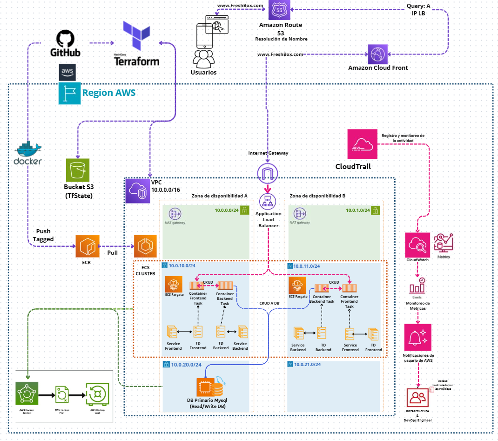
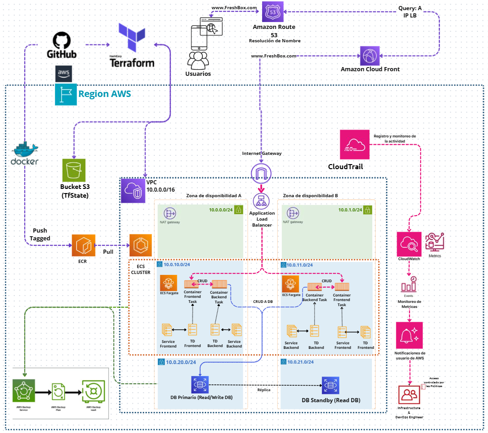
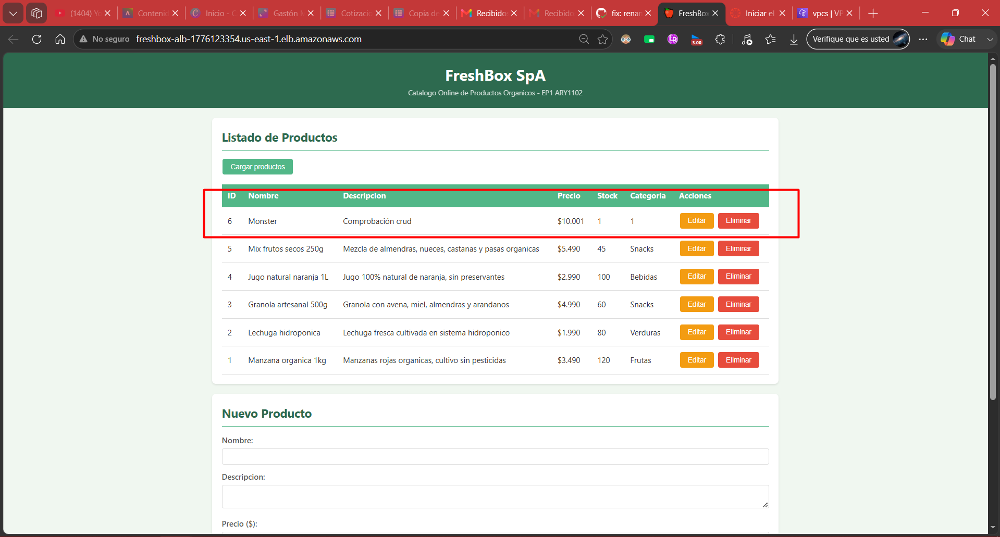
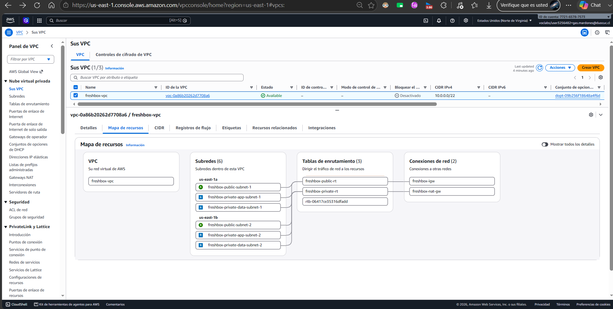
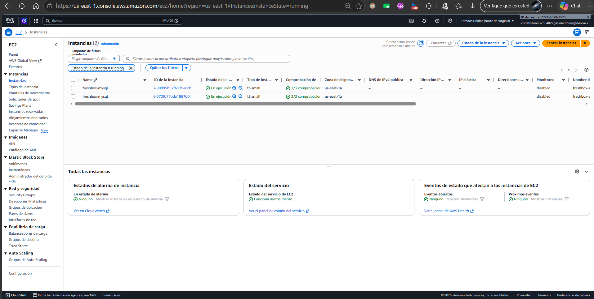
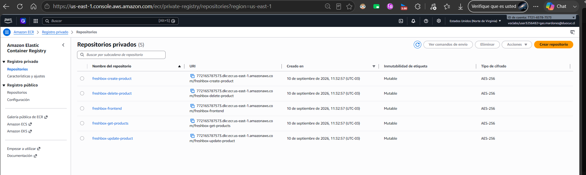
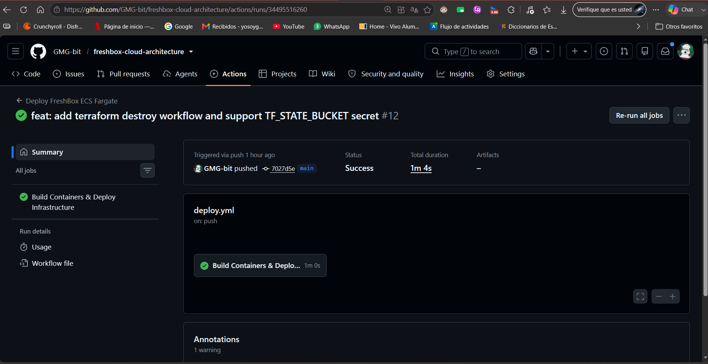
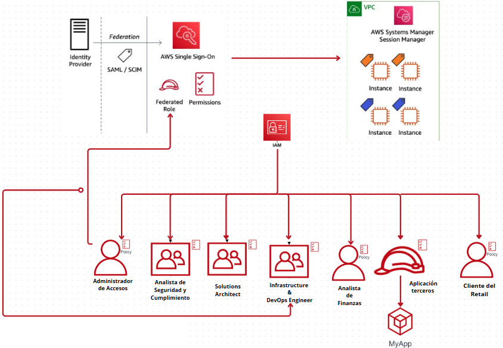

# INFORME TÉCNICO DE ARQUITECTURA CLOUD
## Plataforma Escalable de Catálogo Online de Productos Orgánicos — FreshBox SpA
### Evaluación Parcial N°1 (EP1) — ARY1102: Arquitectura Cloud

---

**Institución:** Duoc UC  
**Escuela:** Informática y Telecomunicaciones  
**Asignatura:** Arquitectura Cloud (Sigla: ARY1102)  
**Semestre:** 2026-02  
**Estudiante:** Gastón Ignacio Mardones González  
**Docente:** Claudio Andrés Núñez Castillo  
**Fecha de Entrega:** 10 de septiembre de 2026  
**Ponderación:** 40% de la Evaluación Parcial N°1  

---

## Índice General

1. [Introducción](#1-introducción)
2. [1.1 Fundamentación del Rol del Arquitecto Cloud (IE1.1.2)](#11-fundamentación-del-rol-del-arquitecto-cloud-ie112)
   - [1.1.1 Definición del Rol del Arquitecto Cloud](#111-definición-del-rol-del-arquitecto-cloud)
   - [1.1.2 Responsabilidades Técnicas y Estratégicas](#112-responsabilidades-técnicas-y-estratégicas)
   - [1.1.3 Alineación con los Objetivos de Negocio y Crecimiento del 40% Trimestral](#113-alineación-con-los-objetivos-de-negocio-y-crecimiento-del-40-trimestral)
3. [1.2 Pilares del Well-Architected Framework (IE1.2.1)](#12-pilares-del-well-architected-framework-ie121)
   - [1.2.1 Descripción de los 6 Pilares AWS](#121-descripción-de-los-6-pilares-aws)
   - [1.2.2 Aplicación de cada Pilar al Contexto de FreshBox SpA](#122-aplicación-de-cada-pilar-al-contexto-de-freshbox-spa)
   - [1.2.3 Vinculación entre Pilares y Necesidades Empresariales](#123-vinculación-entre-pilares-y-necesidades-empresariales)
4. [1.3 Análisis de Arquitectura según Well-Architected (IE1.2.2)](#13-análisis-de-arquitectura-según-well-architected-ie122)
   - [1.3.1 Diagnóstico de Riesgos Identificados](#131-diagnóstico-de-riesgos-identificados)
   - [1.3.2 Oportunidades de Mejora por Pilar](#132-oportunidades-de-mejora-por-pilar)
   - [1.3.3 Recomendaciones Específicas y Plan de Optimización (Fase 1 y Fase 2)](#133-recomendaciones-específicas-y-plan-de-optimización-fase-1-y-fase-2)
5. [1.4 Priorización de Requerimientos (IE1.3.2)](#14-priorización-de-requerimientos-ie132)
   - [1.4.1 Criterios de Clasificación y Priorización](#141-criterios-de-clasificación-y-priorización)
   - [1.4.2 Matriz y Tabla de Priorización de Requerimientos](#142-matriz-y-tabla-de-priorización-de-requerimientos)
   - [1.4.3 Propuesta de Solución Cloud Alineada a Requerimientos Priorizados](#143-propuesta-de-solución-cloud-alineada-a-requerimientos-priorizados)
6. [1.5 Comparación de Modelos de Nube (IE2.1.1)](#15-comparación-de-modelos-de-nube-ie211)
   - [1.5.1 Criterios de Evaluación: Costos, Seguridad y Escalabilidad](#151-criterios-de-evaluación-costos-seguridad-y-escalabilidad)
   - [1.5.2 Tabla Comparativa: Nube Pública, Privada e Híbrida](#152-tabla-comparativa-nube-pública-privada-e-híbrida)
   - [1.5.3 Análisis de Ventajas y Desventajas Específicas para FreshBox SpA](#153-análisis-de-ventajas-y-desventajas-específicas-para-freshbox-spa)
7. [1.6 Justificación del Modelo Cloud (IE2.1.2)](#16-justificación-del-modelo-cloud-ie212)
   - [1.6.1 Selección del Modelo Cloud y Justificación Técnica](#161-selección-del-modelo-cloud-y-justificación-técnica)
   - [1.6.2 Justificación Financiera (Transición de CAPEX a OPEX y TCO)](#162-justificación-financiera-transición-de-capex-a-opex-y-tco)
   - [1.6.3 Justificación Estratégica y Habilitación del Crecimiento del Negocio](#163-justificación-estratégica-y-habilitación-del-crecimiento-del-negocio)
8. [1.7 Validación del Diseño (IE2.2.2)](#17-validación-del-diseño-ie222)
   - [1.7.1 Validación de Alta Disponibilidad (Multi-AZ, ALB, ASG, AWS Backup)](#171-validación-de-alta-disponibilidad-multi-az-alb-asg-aws-backup)
   - [1.7.2 Validación de Escalabilidad (Auto Scaling Group, Microservicios en Contenedores)](#172-validación-de-escalabilidad-auto-scaling-group-microservicios-en-contenedores)
   - [1.7.3 Validación de Buenas Prácticas Arquitectónicas (Segmentación VPC /22, Seguridad Perimetral, Cifrado EBS)](#173-validación-de-buenas-prácticas-arquitectónicas-segmentación-vpc-22-seguridad-perimetral-cifrado-ebs)
9. [Diseño de Arquitectura TO-BE de 3 Capas y Diagramas](#diagramas-de-arquitectura-to-be-de-3-capas)
   - [Topología TO-BE Base Solicitada (3 Capas: ALB + EC2 Docker ASG + EC2 MySQL)](#topología-to-be-base)
   - [Evolución Cloud-Native (ECS Fargate + RDS Multi-AZ)](#evolución-cloud-native-de-la-solución)
10. [Análisis Financiero Detallado y Comparativa de TCO](#análisis-financiero-detallado-y-comparativa-de-tco)
11. [Evidencias de Implementación y Despliegue en AWS Academy Learner Lab](#evidencias-de-implementación-y-despliegue-en-aws-academy-learner-lab)
12. [Anexo: Estrategia de Permisos, Identidad y Gobernanza IAM](#anexo-estrategia-de-permisos-identidad-y-gobernanza-iam)
13. [Conclusiones](#conclusiones)
14. [Bibliografía (Normativa APA v7)](#bibliografía-normativa-apa-v7)
---

## 1. Introducción

FreshBox SpA es una empresa chilena en rápida expansión dedicada al comercio electrónico de productos orgánicos y saludables (frutas seleccionadas, verduras de cultivo limpio, snacks artesanales y bebidas naturales) con cobertura de despacho a domicilio en la Región Metropolitana. En el último periodo fiscal, la compañía ha experimentado un **crecimiento comercial sostenido del 40% trimestral**, lo cual ha sobrepasado los límites operativos y técnicos de su infraestructura heredada (*on-premise* y monolítica). La saturación en horas punta, la rigidez del hardware estático y el riesgo de indisponibilidad ante fallos de servidor impiden capitalizar la creciente demanda del mercado.

Consciente de este desafío, la gerencia de FreshBox SpA ha encomendado al área de Arquitectura Cloud el diseño y la implementación de una solución base en la nube pública de **Amazon Web Services (AWS)**. En esta primera fase (Fase 1), el alcance del proyecto se focaliza en implementar un **catálogo online administrable**, desacoplado mediante una arquitectura de microservicios contenerizados y altamente disponible, que permita visualizar el catálogo público y realizar operaciones CRUD completas sobre los productos orgánicos de la empresa (creación, edición, consulta y eliminación). Las funcionalidades accesorias, tales como la pasarela de pagos, el carrito de compras dinámico y el procesamiento de órdenes masivas, han sido planificadas para fases posteriores de la hoja de ruta digital.

El presente informe técnico consolida las decisiones arquitectónicas adoptadas, articulando la fundamentación técnica, financiera y estratégica del modelo cloud elegido. El diseño ha sido concebido y evaluado bajo los lineamientos del **AWS Well-Architected Framework**, garantizando una estricta segmentación de red en 3 capas (Pública, Privada de Aplicación y Privada de Datos) sobre una VPC Multi-AZ (`/22`), mecanismos de autoescalabilidad, políticas de aislamiento perimetral mediante Security Groups encadenados y cifrado integral de datos en reposo y tránsito. Asimismo, se documenta la validación teórica y práctica del entorno desplegado en **AWS Academy Learner Lab**, asegurando una transición segura, costo-eficiente y resiliente hacia la computación en la nube.

---

## 1.1 Fundamentación del Rol del Arquitecto Cloud (IE1.1.2)

### 1.1.1 Definición del Rol del Arquitecto Cloud

El Arquitecto Cloud actúa como el **articulador estratégico y técnico** entre los objetivos comerciales de la organización y las capacidades habilitadoras de la tecnología en la nube. En una organización moderna en proceso de transformación digital, este profesional no se limita a diseñar diagramas de red o seleccionar servidores; su rol primario es concebir ecosistemas tecnológicos elásticos, confiables, seguros y costo-optimizados que aceleren el valor del negocio, minimicen los riesgos operativos y permitan a la empresa adaptarse velozmente a las cambiantes demandas del mercado.

### 1.1.2 Responsabilidades Técnicas y Estratégicas

El rol del Arquitecto Cloud en FreshBox SpA abarca dos dimensiones complementarias e interdependientes:

#### A. Responsabilidades Técnicas:
1. **Diseño de Topología y Segmentación de Red:** Concebir una infraestructura virtual privada (VPC) con esquemas de direccionamiento IPv4 eficientes (`/22`), segmentando el tráfico en subredes públicas y privadas en múltiples Zonas de Disponibilidad (Multi-AZ) para eliminar puntos únicos de falla (SPOF).
2. **Selección y Dimensionamiento de Servicios (Right-Sizing):** Determinar la idoneidad de los paradigmas de cómputo (IaaS vs PaaS vs CaaS vs Serverless), seleccionando tipos de instancias optimizadas (ej. familias ARM Graviton `t4g.small` o microservicios en Docker/ECS) de acuerdo con los perfiles de carga del sistema.
3. **Diseño de Seguridad Perimetral y Defensa en Profundidad:** Configurar firewalls virtuales (Security Groups y Network ACLs), implementar el principio de mínimo privilegio en IAM, y asegurar el cifrado de datos tanto en reposo (AWS KMS / EBS Encryption) como en tránsito (TLS/HTTPS).
4. **Estrategias de Resiliencia y Recuperación ante Desastres (DR):** Definir y parametrizar los objetivos de tiempo de recuperación (**RTO**) y objetivos de punto de recuperación (**RPO**), integrando servicios como Application Load Balancers (ALB) y planes automatizados de respaldo mediante AWS Backup.
5. **Automatización y DevOps:** Promover el despliegue de Infraestructura como Código (**IaC**) mediante herramientas como Terraform y orquestar flujos de Integración y Entrega Continua (**CI/CD**) mediante GitHub Actions.

#### B. Responsabilidades Estratégicas:
1. **Alineación Estratégica Negocio-Tecnología:** Garantizar que cada dólar invertido en la nube responda directamente a la captura de cuota de mercado, retención de clientes o mejora de márgenes operativos.
2. **Optimización Financiera y Gobernanza del Gasto (FinOps):** Guiar la transición desde modelos de gasto de capital intensivo (**CAPEX**) hacia modelos de gasto operativo elástico (**OPEX**), monitoreando costos unitarios por transacción y evitando el sobredimensionamiento de recursos.
3. **Reducción del Time-to-Market:** Proveer una plataforma estandarizada y modular (microservicios y contenedores) que permita a los desarrolladores liberar nuevas características comerciales en cuestión de días u horas, frente a los ciclos tradicionales de semanas o meses.
4. **Mitigación del Riesgo Corporativo:** Salvaguardar la reputación de la marca protegiendo la confidencialidad de la información corporativa y garantizando la continuidad operativa 24/7.

```
       +-------------------------------------------------------------+
       |                  OBJETIVOS DEL NEGOCIO                      |
       |  - Crecimiento 40% trimestral    - Retención de Clientes    |
       |  - Despacho continuo en RM       - Reducción de Costos Fijos|
       +------------------------------+------------------------------+
                                      |
                           [ ARQUITECTO CLOUD ]
                   Puente Estratégico y Traductor Tecnológico
                                      |
       +------------------------------+------------------------------+
       |               SOLUCIONES TÉCNICAS EN AWS                    |
       |  - VPC Multi-AZ /22              - Auto Scaling (2 a 4 EC2) |
       |  - ALB + 5 Contenedores Docker   - EC2 MySQL + AWS Backup   |
       |  - Security Groups por Capa      - Cifrado EBS + Terraform  |
       +-------------------------------------------------------------+
```

### 1.1.3 Alineación con los Objetivos de Negocio y Crecimiento del 40% Trimestral

El ritmo de crecimiento del **40% trimestral** de FreshBox SpA representa una prueba crítica de viabilidad técnica:
- **El problema de la arquitectura heredada:** En un modelo *on-premise*, el crecimiento acelerado obliga a realizar compras periódicas de hardware que conllevan tiempos de adquisición prolongados (lead times de 6 a 12 semanas), sobrecostos por aprovisionamiento pico (hardware ocioso el 80% del tiempo) y caídas del portal web durante campañas comerciales agresivas.
- **La solución del Arquitecto Cloud:** Mediante una arquitectura elástica basada en **AWS**, el cómputo y la red escalan de forma automatizada y horizontal en respuesta a la demanda real. El uso de **Auto Scaling Groups (ASG)** con umbrales dinámicos (mínimo 2 instancias distribuidas en dos Zonas de Disponibilidad `us-east-1a` y `us-east-1b`, escalables hasta 4 instancias) garantiza que los clientes de la Región Metropolitana experimenten tiempos de carga instantáneos, mientras la empresa paga únicamente por la capacidad que consume en cada momento.

---

## 1.2 Pilares del Well-Architected Framework (IE1.2.1)

El AWS Well-Architected Framework provee directrices y mejores prácticas para diseñar soluciones cloud seguras, resilientes, eficientes y rentables. La arquitectura diseñada para FreshBox SpA aborda rigurosamente sus seis pilares fundamentales:

```
                      +-----------------------------+
                      | AWS Well-Architected Pillars|
                      +--------------+--------------+
       +--------------+--------------+--------------+--------------+
       |              |              |              |              |
+-------------++-------------++-------------++-------------++-------------++-------------+
| 1.Excelencia|| 2.Seguridad ||3.Fiabilidad ||4.Eficiencia || 5.Costos   ||6.Sostenibi- |
|  Operativa  ||             ||             || Rendimiento ||            ||   lidad      |
+-------------++-------------++-------------++-------------++-------------++-------------+
```

### 1.2.1 Descripción de los 6 Pilares AWS

1. **Excelencia Operativa (Operational Excellence):** Capacidad de operar y monitorear sistemas para entregar valor empresarial, así como mejorar continuamente los procesos y procedimientos de soporte.
2. **Seguridad (Security):** Capacidad de proteger información, sistemas y activos, aprovechando las tecnologías en la nube para mejorar la postura de seguridad y cumplir requisitos normativos.
3. **Fiabilidad (Reliability):** Capacidad de una carga de trabajo para desempeñar su función prevista de forma correcta y coherente cuando se espera que lo haga, mitigando fallos y recuperándose automáticamente.
4. **Eficiencia del Rendimiento (Performance Efficiency):** Capacidad de utilizar los recursos informáticos de forma eficiente para cumplir los requisitos del sistema y mantener esa eficiencia a medida que la demanda cambia y las tecnologías evolucionan.
5. **Optimización de Costos (Cost Optimization):** Capacidad de ejecutar sistemas para ofrecer valor comercial al precio más bajo posible, evitando gastos innecesarios y optimizando el retorno de la inversión.
6. **Sostenibilidad (Sustainability):** Capacidad de minimizar continuamente los impactos ambientales de la ejecución de cargas de trabajo en la nube, optimizando el consumo energético y la huella de carbono.

### 1.2.2 Aplicación de cada Pilar al Contexto de FreshBox SpA

1. **Excelencia Operativa:**
   - La infraestructura completa se aprovisiona mediante **Terraform (IaC)**, eliminando errores de configuración humana en la consola.
   - El empaquetamiento de las aplicaciones se estandariza con **Docker**, garantizando paridad idéntica entre el ambiente de desarrollo local y la nube de AWS.
   - Se implementan canalizaciones de **CI/CD con GitHub Actions**, permitiendo el despliegue desatendido de nuevas versiones en Amazon ECR.
2. **Seguridad:**
   - Implementación de **Defensa en Profundidad (Defense-in-Depth)** mediante una topología estricta de red de 3 capas.
   - Las instancias de cómputo y de base de datos se alojan exclusivamente en **subredes privadas**, careciendo por diseño de direcciones IP públicas.
   - Las conexiones se restringen rigurosamente a través de **Security Groups encadenados**: el ALB solo atiende puertos 80/443 a internet (`0.0.0.0/0`), las EC2 de aplicación solo admiten tráfico desde el Security Group del ALB, y el servidor MySQL sólo permite peticiones por el puerto 3306 provenientes del Security Group de aplicación.
   - Cifrado obligatorio en reposo para todos los volúmenes **EBS Encryption** mediante claves administradas por AWS KMS.
3. **Fiabilidad:**
   - Despliegue **Multi-AZ** distribuido entre las Zonas de Disponibilidad `us-east-1a` y `us-east-1b`.
   - Distribución inteligente de carga mediante **Application Load Balancer (ALB)** equipado con *Target Groups* y comprobaciones continuas de estado (*health checks* en ruta `/`).
   - El grupo de Auto Scaling mantiene un mínimo estricto de 2 instancias activas en distintas zonas; si una instancia o zona falla, el tráfico se redirige instantáneamente y el sistema aprovisiona un reemplazo sano.
   - Protección contra pérdida de datos en la capa MySQL mediante **AWS Backup**, ejecutando snapshots incrementales diarios y reteniendo copias de contingencia con restauración proyectada en `us-east-1b`.
4. **Eficiencia del Rendimiento:**
   - Adopción de procesadores **AWS Graviton (arquitectura ARM64 en instancias `t4g.small`)**, los cuales brindan hasta un 40% de mejor relación rendimiento-precio en comparación con arquitecturas x86 tradicionales para servidores web y bases de datos relacionales.
   - Desacoplamiento de la aplicación monolítica en **5 microservicios ligeros** (1 frontend en Nginx y 4 microservicios backend especializados en Node.js Express), lo que evita la contención de hilos y cuellos de botella de procesamiento.
5. **Optimización de Costos:**
   - Modelo de dimensionamiento ajustado (*right-sizing*): instancias `t4g.small` (2 vCPU, 2 GB RAM) con un costo nominal base de ~$12.26 USD al mes por instancia.
   - Los Auto Scaling Groups escalan dinámicamente: la empresa no paga por 4 servidores las 24 horas del día, sino solo cuando el tráfico lo justifica.
   - La eliminación de licencias comerciales propietarias al utilizar software de código abierto (Linux Alpine, Node.js, MySQL Community) maximiza el ahorro operativo.
6. **Sostenibilidad:**
   - El uso de procesadores AWS Graviton reduce el consumo de energía eléctrica por cómputo útil en más de un 60% frente a CPUs convencionales.
   - Los contenedores Docker empaquetados bajo imágenes base Alpine minimizan el uso de almacenamiento, reduciendo el tráfico de datos y la energía en la red de transferencia.

### 1.2.3 Vinculación entre Pilares y Necesidades Empresariales

| Pilar AWS | Necesidad Empresarial de FreshBox SpA | Impacto Directo en el Negocio |
| :--- | :--- | :--- |
| **Excelencia Operativa** | Reducción de caídas operativas y despliegues sin tiempo de inactividad (*zero-downtime*). | Lanzamiento ágil de promociones de catálogo orgánico sin interrumpir las ventas de los clientes. |
| **Seguridad** | Cumplimiento normativo de protección de datos comerciales e inventario. | Blindaje contra accesos no autorizados, fuga de listas de precios y robo de datos de la empresa. |
| **Fiabilidad** | Continuidad de servicio 24/7 en la Región Metropolitana durante picos de compras. | Erradicación de ventas perdidas por caída del portal web; disponibilidad de catálogo garantizada (99.9%). |
| **Eficiencia de Rendimiento**| Carga rápida del catálogo interactivo en navegadores de escritorio y móviles. | Menor tasa de rebote web, aumento de la tasa de conversión y experiencia de usuario fluida. |
| **Optimización de Costos** | Mantener la rentabilidad unitaria ante una tasa de crecimiento del 40%. | Los costos de infraestructura crecen de manera proporcional a las ventas, manteniendo un TCO predecible. |
| **Sostenibilidad** | Coherencia de marca entre productos ecológicos y la huella ecológica de TI. | Refuerzo del valor de marca y compromiso ambiental corporativo de FreshBox SpA. |

---

## 1.3 Análisis de Arquitectura según Well-Architected (IE1.2.2)

### 1.3.1 Diagnóstico de Riesgos Identificados

Se ha realizado una auditoría exhaustiva sobre la arquitectura base inicial (diseño en 3 capas con EC2+Docker y EC2 MySQL dedicado) identificando los riesgos intrínsecos que deben ser mitigados durante el ciclo de vida del proyecto.

### 1.3.2 Oportunidades de Mejora por Pilar

| Pilar | Riesgo Identificado en la Arquitectura Base | Severidad | Oportunidad de Mejora |
| :--- | :--- | :---: | :--- |
| **Excelencia Operacional** | Dependencia de scripts de inicio (`user-data`) y despliegues manuales en EC2 que pueden fallar por problemas transitorios de red. | Media | Adopción de orquestación administrada de contenedores (Amazon ECS) e infraestructura como código con pipelines declarativos. |
| **Seguridad** | Almacenamiento de credenciales de base de datos (`DB_USER`, `DB_PASS`) en variables de entorno locales de los contenedores. | Alta | Centralizar y rotar credenciales dinámicamente mediante **AWS Secrets Manager** o **AWS Systems Manager Parameter Store**. |
| **Fiabilidad** | La capa de datos reside en una única instancia EC2 (`freshbox-mysql`), constituyendo un Punto Único de Falla (SPOF) en la escritura de datos. | Alta | Implementar redundancia activa con conmutación por error automática mediante **Amazon RDS MySQL Multi-AZ**. |
| **Eficiencia de Rendimiento**| El frontend Nginx y los activos estáticos (CSS, imágenes) se sirven directamente desde las instancias de cómputo en EC2. | Media | Integrar una red de distribución de contenidos (**Amazon CloudFront**) combinada con un bucket **Amazon S3** para descargar tráfico de cómputo. |
| **Optimización de Costos** | El tráfico saliente de las subredes privadas hacia ECR y servicios de AWS transita por el NAT Gateway, acumulando cobros de datos procesados ($0.045/GB). | Media | Configurar **VPC Endpoints (AWS PrivateLink)** para ECR, S3 y CloudWatch, manteniendo el tráfico en la red interna de AWS sin costo de NAT. |
| **Sostenibilidad** | Las instancias EC2 se mantienen activas incluso en periodos de inactividad nocturna si no se calibran agresivamente las políticas de escalado. | Baja | Ajustar políticas de escalado programado (*scheduled scaling*) para reducir la flota al mínimo absoluto en horarios no comerciales (01:00 a 06:00). |

### 1.3.3 Recomendaciones Específicas y Plan de Optimización (Fase 1 y Fase 2)

```
+-----------------------------------------------------------------------------------------+
|                               HOJA DE RUTA ARQUITECTÓNICA                               |
+-----------------------------------------------------------------------------------------+
| FASE 1 (Implementada - Encargo EP1):                                                    |
|  - VPC /22 Multi-AZ con 6 subredes y estricta segmentación pública/privada.             |
|  - Application Load Balancer público con comprobación de estado y balanceo de carga.     |
|  - Cómputo: EC2 t4g.small con Docker ejecutando 5 microservicios desacoplados.          |
|  - Auto Scaling Group (2 a 4 instancias) distribuido en AZ1a y AZ1b.                    |
|  - Capa de datos: EC2 t4g.small con MySQL dedicado + volúmenes EBS cifrados.            |
|  - Copias de seguridad periódicas automatizadas con AWS Backup.                         |
|  - Automatización base mediante Terraform y GitHub Actions.                             |
+-----------------------------------------------------------------------------------------+
                                             |
                                             v
+-----------------------------------------------------------------------------------------+
| FASE 2 (Recomendaciones de Evolución y Escalamiento):                                   |
|  - Migración de EC2 MySQL a Amazon RDS Multi-AZ con réplica de lectura y failover auto. |
|  - Evolución de EC2+Docker a CaaS Serverless con Amazon ECS Fargate (cero parches SO). |
|  - Descarga de activos estáticos a Amazon S3 + aceleración perimetral con CloudFront.  |
|  - Protección de secretos de base de datos con AWS Secrets Manager.                     |
|  - VPC Endpoints para ECR, S3 y CloudWatch (reducción de costos de NAT Gateway).        |
|  - Inspección perimetral y mitigación de ataques web con AWS WAF.                       |
+-----------------------------------------------------------------------------------------+
```

---

## 1.4 Priorización de Requerimientos (IE1.3.2)

### 1.4.1 Criterios de Clasificación y Priorización

Para garantizar que las decisiones de inversión tecnológica generen el máximo impacto, los requerimientos se clasifican en **Requerimientos de Negocio** y **Requerimientos Técnicos** (subdivididos en Funcionales y No Funcionales). La priorización se realiza con base en una matriz de tres criterios de ponderación:
1. **Impacto en el Negocio (IN):** Criticidad para mantener las ventas, evitar pérdidas de ingresos y asegurar la continuidad comercial.
2. **Urgencia Operativa (UO):** Relevancia para absorber el crecimiento del 40% trimestral de FreshBox sin saturar los recursos.
3. **Factibilidad y Dependencia Arquitectónica (FD):** Grado en que otros componentes o módulos dependen de la implementación previa de este elemento.

Niveles asignados:
- **Alta:** Requerimiento nuclear indispensable para la salida a producción en Fase 1.
- **Media:** Requerimiento fundamental de calidad y optimización; su ausencia degrada el rendimiento o la mantenibilidad, pero no bloquea la operación básica.
- **Baja:** Característica de mejora continua programada para despliegue diferido en Fase 2.

### 1.4.2 Matriz y Tabla de Priorización de Requerimientos

| ID | Clasificación | Categoría | Descripción del Requerimiento | Prioridad | Criterios / Justificación |
| :--- | :--- | :--- | :--- | :---: | :--- |
| **RN01** | Negocio | Estrategia | Soportar el crecimiento comercial del 40% trimestral de la empresa sin degradación del servicio. | **Alta** | Si la plataforma colapsa ante el aumento de demanda, FreshBox pierde clientes y credibilidad en el mercado orgánico. |
| **RN02** | Negocio | Operación | Permitir la visualización y administración centralizada del catálogo de productos orgánicos. | **Alta** | Core del modelo comercial de la empresa. Base para captar pedidos de frutas, verduras y abarrotes naturales. |
| **RN03** | Negocio | Financiero | Sustituir inversiones de capital inicial (**CAPEX**) por gasto operativo flexible (**OPEX**) y optimizar el TCO. | **Alta** | Preserva la liquidez financiera de la startup y alinea los desembolsos de TI con las ventas efectivamente percibidas. |
| **RF01** | Técnico | Funcional | Módulo de consulta de catálogo: endpoint `/api/products` vía HTTP GET (listado y detalle). | **Alta** | Acceso público de clientes para explorar el catálogo disponible de productos y sus atributos (precio, stock). |
| **RF02** | Técnico | Funcional | Módulo de creación de productos: endpoint `/api/products` vía HTTP POST (exclusivo para administradores). | **Alta** | Permite ingresar nuevos productos orgánicos al inventario de FreshBox en tiempo real. |
| **RF03** | Técnico | Funcional | Módulo de actualización de productos: endpoint `/api/products/:id` vía HTTP PUT. | **Alta** | Vital para mantener actualizados precios, descripciones y disponibilidad de stock ante cambios de temporada. |
| **RF04** | Técnico | Funcional | Módulo de eliminación de productos: endpoint `/api/products/:id` vía HTTP DELETE. | **Alta** | Permite descontinuar productos caducados o agotados del catálogo visible. |
| **RF05** | Técnico | Funcional | Interfaz web responsiva servida por Nginx en puerto 80 integrada con las APIs backend. | **Alta** | Punto de contacto visual del cliente final y del operador administrativo. |
| **RNF01**| Técnico | No Funcional | Alta Disponibilidad mínima del 99.9% frente a contingencias en el centro de datos. | **Alta** | Resuelto mediante topología Multi-AZ (dos zonas de disponibilidad `us-east-1a` y `us-east-1b`) y balanceo con ALB. |
| **RNF02**| Técnico | No Funcional | Escalabilidad automática elástica de la capa de aplicación. | **Alta** | Manejado mediante Auto Scaling Group de 2 a 4 instancias `t4g.small` según umbrales de utilización. |
| **RNF03**| Técnico | No Funcional | Aislamiento perimetral y segmentación estricta de red en 3 capas. | **Alta** | VPC `/22` con subredes privadas para cómputo y base de datos, reguladas por Security Groups encadenados. |
| **RNF04**| Técnico | No Funcional | Cifrado obligatorio de datos en reposo y tránsito. | **Media** | Volúmenes EBS con cifrado AES-256 (KMS) y comunicación externa segura vía balanceador de carga. |
| **RNF05**| Técnico | No Funcional | Mecanismos de recuperación ante desastres (DR) y respaldo continuo de datos. | **Media** | Políticas automatizadas con AWS Backup para capturas diarias de la base de datos MySQL con retención de 7 días. |
| **RNF06**| Técnico | No Funcional | Latencia de respuesta en carga de catálogo inferior a 2 segundos. | **Media** | Logrado mediante microservicios independientes sobre arquitectura ARM Graviton y baja latencia interna en la VPC. |
| **RNF07**| Técnico | No Funcional | Infraestructura como Código (IaC) versionada y reproducible. | **Media** | Definición íntegra de componentes en Terraform, facilitando ambientes idénticos de Dev/Staging/Prod. |
| **RNF08**| Técnico | No Funcional | Pipeline automatizado de CI/CD para construcción y despliegue de contenedores. | **Media** | Automatización en GitHub Actions compilando imágenes Docker para arquitectura ARM64 y empujando a Amazon ECR. |
| **RNF09**| Técnico | No Funcional | Monitoreo y telemetría de eventos de seguridad y rendimiento. | **Baja** | Registro centralizado con Amazon CloudWatch y CloudTrail. |

### 1.4.3 Propuesta de Solución Cloud Alineada a Requerimientos Priorizados

La solución técnica diseñada mapea de manera directa los requerimientos priorizados:
1. **Atención de Requerimientos de Negocio (RN01, RN02, RN03):** La arquitectura en AWS garantiza escalabilidad elástica sin comprometer inversión en hardware, habilitando el catálogo online administrable y controlando el costo operativo mensual entre $80 y $150 USD.
2. **Atención de Requerimientos Funcionales (RF01 - RF05):** Se desacopla la aplicación en **5 contenedores Docker** independientes:
   - Contenedor 1: `frontend` (Nginx + HTML/JS en puerto 80).
   - Contenedor 2: `get-products` (Node.js Express en puerto 3001).
   - Contenedor 3: `create-product` (Node.js Express en puerto 3002).
   - Contenedor 4: `update-product` (Node.js Express en puerto 3003).
   - Contenedor 5: `delete-product` (Node.js Express en puerto 3004).
3. **Atención de Requerimientos No Funcionales (RNF01 - RNF09):** Topología de red en VPC con 6 subredes en dos zonas de disponibilidad, Application Load Balancer que distribuye tráfico y ejecuta *health checks*, instancias `t4g.small` administradas por un Auto Scaling Group, base de datos MySQL en subred privada con AWS Backup y volúmenes EBS cifrados.

---

## 1.5 Comparación de Modelos de Nube (IE2.1.1)

### 1.5.1 Criterios de Evaluación: Costos, Seguridad y Escalabilidad

Para tomar una decisión fundamentada sobre el modelo de despliegue informático que mejor sirve a los objetivos estratégicos de FreshBox SpA, se evaluaron los tres modelos de computación en la nube existentes bajo tres criterios normativos:
1. **Costos:** Evaluación de la estructura financiera (**CAPEX** vs **OPEX**), costo total de adquisición, costos recurrentes de administración de centros de datos, licenciamiento y riesgo financiero por capacidad ociosa.
2. **Seguridad:** Modelo de gobernanza, perímetro de aislamiento, control sobre activos físicos y lógicos, gestión de actualizaciones de seguridad y cumplimiento normativo.
3. **Escalabilidad:** Velocidad de provisión de nuevos recursos, elasticidad ante picos imprevisibles de tráfico, automatización y capacidad de expansión geográfica sin fricción.

### 1.5.2 Tabla Comparativa: Nube Pública, Privada e Híbrida

| Criterio | Nube Pública (AWS) | Nube Privada (On-Premise / Hosted) | Nube Híbrida |
| :--- | :--- | :--- | :--- |
| **Estructura de Costos** | **100% OPEX (Gasto Operativo):** Pago exclusivamente por consumo real por segundo o por hora. Inversión inicial de capital nula ($0 CAPEX). | **Intensiva en CAPEX:** Requiere adquisición por adelantado de servidores, switches, almacenamiento SAN, licencias, sistemas de climatización y energía ininterrumpida (UPS). | **Mixta:** Requiere fuerte inversión inicial en infraestructura local más los costos variables de la nube pública conectada. |
| **Costo Total de Propiedad (TCO)** | **Bajo y Predecible:** Se eliminan los gastos de mantenimiento de instalaciones físicas, garantías de hardware, contratos de soporte de centros de datos y personal de soporte físico. | **Muy Alto:** La organización absorbe el 100% de los costos operativos fijos, fallas de hardware y reemplazo de componentes cada 3 a 5 años. | **Elevado:** La coexistencia de dos mundos multiplica la necesidad de herramientas de gestión cruzada y personal especializado. |
| **Seguridad y Cumplimiento** | **Modelo de Responsabilidad Compartida:** AWS protege la infraestructura física, hipervisores y red global bajo certificaciones internacionales (SOC 1/2/3, ISO 27001, PCI-DSS). El cliente gestiona datos, accesos y reglas de firewall. | **Control Total pero Vulnerable:** La seguridad física y lógica recae exclusivamente en la empresa. Cualquier parche omitido o falla física de seguridad compromete la totalidad del sistema. | **Complejidad Elevada:** Requiere unificar políticas de seguridad, cifrado en túneles VPN/Direct Connect y gestión de identidades federadas complejas. |
| **Escalabilidad y Elasticidad** | **Casi Ilimitada e Instantánea:** Los recursos se escalan automáticamente de forma horizontal o vertical en minutos mediante políticas automatizadas de Auto Scaling. | **Rígida y Limitada:** El escalamiento está restringido a la capacidad física del rack. Adquirir nuevos servidores toma semanas o meses (procesos de compra, aduanas, montaje). | **Flexible pero Condicionada:** Permite *Cloud Bursting* (desbordamiento hacia la nube pública durante picos), pero exige sincronización compleja de datos entre entornos. |
| **Alta Disponibilidad** | **Nativa Multi-AZ:** Despliegue en centros de datos geográficamente separados pero interconectados con latencia menor a 1 ms sin costo exorbitante. | **Extremadamente Costosa:** Construir un segundo centro de datos réplica para redundancia física resulta inviable financieramente para una startup. | **Alta:** Permite esquemas de contingencia activa, pero con requerimientos muy complejos de red privada y replicación de datos. |
| **Time-to-Market** | **Inmediato:** Servicios gestionados (bases de datos, repositorios de imágenes, balanceadores) listos para aprovisionar por API o código en minutos. | **Lento:** Ciclos de semanas para aprovisionar entornos de prueba, homologación y despliegue de nuevos servicios. | **Medio:** Retardado por la necesidad de asegurar la compatibilidad e interoperabilidad entre capas locales y remotas. |

### 1.5.3 Análisis de Ventajas y Desventajas Específicas para FreshBox SpA

#### Nube Pública (AWS):
- **Ventajas:** Es el modelo idóneo para una empresa en fase de hipercrecimiento (+40% trimestral). Elimina por completo las barreras de capital, permite activar alta disponibilidad Multi-AZ con costos contenidos ($80 - $150 USD/mes), y habilita la adopción de microservicios contenerizados y prácticas DevOps modernas.
- **Desventajas:** Dependencia de la conectividad a internet para la gestión y necesidad de monitorear el consumo para evitar sobrecostos por recursos olvidados (mitigado mediante alertas de presupuesto en AWS Budgets e IaC).

#### Nube Privada (On-Premise):
- **Ventajas:** Control absoluto sobre la ubicación física de los servidores y ausencia de tarifas de transferencia externa para usuarios en red local.
- **Desventajas:** Inviable para FreshBox SpA. Estrangularía el flujo de caja de la empresa exigiendo miles de dólares en servidores que tardarían semanas en llegar. La empresa colapsaría ante los picos de demanda del 40% trimestral por incapacidad de adquirir hardware a la misma velocidad que crecen sus ventas.

#### Nube Híbrida:
- **Ventajas:** Permite mantener sistemas legados locales mientras se explota la elasticidad de la nube pública.
- **Desventajas:** Innecesariamente compleja para FreshBox SpA. FreshBox no cuenta con sistemas heredados en mainframe ni restricciones regulatorias de soberanía de datos que justifiquen pagar por un centro de datos propio más enlaces dedicados hacia AWS.

---

## 1.6 Justificación del Modelo Cloud (IE2.1.2)

Habiendo confrontado las alternativas existentes, se concluye formalmente que el modelo de **Nube Pública**, implementado sobre la plataforma de **Amazon Web Services (AWS)**, es la única opción estratégica y técnicamente coherente para FreshBox SpA.

```
+-----------------------------------------------------------------------------------------+
|                  JUSTIFICACIÓN INTEGRAL DE SELECCIÓN DE NUBE PÚBLICA                    |
+-----------------------------------------------------------------------------------------+
|                                                                                         |
|   +--------------------------+  +--------------------------+  +---------------------+   |
|   |   JUSTIFICACIÓN TÉCNICA  |  | JUSTIFICACIÓN FINANCIERA |  |JUSTIFICACIÓN ESTRAT.|   |
|   +--------------------------+  +--------------------------+  +---------------------+   |
|   | - Multi-AZ nativo        |  | - Reducción CAPEX a OPEX |  | - Foco en el negocio|   |
|   | - ALB inteligente        |  | - Cero inversión inicial |  | - Absorción del 40% |   |
|   | - Contenedores en ECR    |  | - Pago por uso exacto    |  | - Time-to-market    |   |
|   | - Auto Scaling dinámico  |  | - TCO predecible y bajo  |  | - Innovación ágil   |   |
|   | - IaC con Terraform      |  | - Sin costos ociosos     |  | - Ventaja comercial |   |
|   +--------------------------+  +--------------------------+  +---------------------+   |
|                                                                                         |
+-----------------------------------------------------------------------------------------+
```

### 1.6.1 Selección del Modelo Cloud y Justificación Técnica

Desde el punto de vista arquitectónico, AWS provee bloques constructivos modulares que resuelven los requerimientos de FreshBox sin requerir desarrollos ad-hoc:
- **Red Aislada y Resiliente (Amazon VPC Multi-AZ):** Facilita la creación de una nube privada virtual sobre un bloque CIDR `/22` con subredes redundantes en dos zonas independientes (`us-east-1a` y `us-east-1b`), posibilitando el aislamiento del cómputo y los datos respecto del tráfico público.
- **Balanceo y Enrutamiento Inteligente (Application Load Balancer):** Distribuye automáticamente las peticiones entrantes entre instancias de cómputo sanas mediante comprobaciones de salud a nivel de aplicación (capa 7).
- **Elasticidad Horizontal de Cómputo (Auto Scaling Group):** Permite desplegar instancias `t4g.small` impulsadas por procesadores AWS Graviton ARM64, capaces de soportar los 5 microservicios de la plataforma y escalar automáticamente desde 2 hasta 4 nodos según la demanda de los clientes.
- **Ecosistema de Contenedores y Repositorios Gestionados (Amazon ECR):** Ofrece un registro privado de contenedores altamente disponible y seguro, con cifrado integrado en reposo y escaneo de vulnerabilidades.
- **Automatización e Infraestructura como Código (IaC):** La compatibilidad integral con Terraform permite versionar y replicar el 100% de la infraestructura en segundos, erradicando discrepancias entre entornos.

### 1.6.2 Justificación Financiera (Transición de CAPEX a OPEX y TCO)

La elección del modelo financiero es determinante para la salud económica de FreshBox SpA:
1. **Erradicación del CAPEX:** La adquisición de servidores físicos, licencias perpetuas de virtualización, switches y equipos de respaldo para montar un centro de datos equivalente con redundancia Multi-AZ requeriría una inversión de capital inicial estimada en más de **$25,000 - $35,000 USD**. En contraste, la puesta en marcha en AWS requirió **$0 USD en CAPEX**.
2. **Adopción de un Modelo 100% OPEX (Pay-as-you-go):** Los recursos se facturan como gasto operativo corriente en función del tiempo y la capacidad efectiva utilizada. El costo de ejecución mensual de la solución base en AWS para el encargo se mantiene en un rango acotado de **$80 a $150 USD mensuales**, lo cual es perfectamente asumible por una empresa con crecimiento de facturación del 40% trimestral.
3. **Optimización del Costo Total de Propiedad (TCO):** El TCO de la nube pública es sustancialmente menor porque AWS absorbe las tareas de reemplazo de hardware defectuoso, actualización de hipervisores, suministro eléctrico redundante, conectividad de fibra óptica y seguridad física de las instalaciones.

### 1.6.3 Justificación Estratégica y Habilitación del Crecimiento del Negocio

Estratégicamente, el negocio de FreshBox SpA radica en la comercialización y entrega oportuna de alimentos orgánicos, no en la gestión y resolución de incidencias en centros de datos:
- **Foco Central en la Propuesta de Valor:** Al delegar la complejidad operativa de la infraestructura física a AWS, el talento de ingeniería de FreshBox puede concentrarse al 100% en optimizar la experiencia de usuario, incorporar nuevos productos al catálogo y refinar la logística de despachos.
- **Habilitación Directa del Crecimiento del 40%:** Una infraestructura estática se convierte en un cuello de botella que frena el crecimiento del negocio. La solución en AWS garantiza que cuando las campañas de marketing o la expansión a nuevas comunas de la RM generen un incremento repentino de compradores, la plataforma responda de forma autónoma y transparente, transformando las oportunidades de venta en facturación real sin caídas de servicio.

---

## 1.7 Validación del Diseño (IE2.2.2)

La validación técnica del diseño garantiza que la arquitectura propuesta cumple con los más altos estándares de disponibilidad, escalabilidad y seguridad exigidos en la evaluación académica.

```
+-----------------------------------------------------------------------------------------+
|                  MATRIZ DE VALIDACIÓN TÉCNICA DEL DISEÑO EP1                            |
+-----------------------------------------------------------------------------------------+
|                                                                                         |
|   +--------------------------+  +--------------------------+  +---------------------+   |
|   |   ALTA DISPONIBILIDAD    |  |       ESCALABILIDAD      |  |   BUENAS PRÁCTICAS  |   |
|   +--------------------------+  +--------------------------+  +---------------------+   |
|   | - Multi-AZ (AZ1a/AZ1b)   |  | - ASG (Mín: 2, Máx: 4)   |  | - VPC /22 (6 subnets|   |
|   | - ALB + Health Checks    |  | - 5 Contenedores Docker  |  | - SG Encadenados    |   |
|   | - AWS Backup (DR AZ1b)   |  | - Desacoplamiento APIs   |  | - Cifrado EBS (KMS) |   |
|   | - Target Groups duales   |  | - Procesadores ARM Grav. |  | - NAT Gateway priv. |   |
|   +--------------------------+  +--------------------------+  +---------------------+   |
|                                                                                         |
+-----------------------------------------------------------------------------------------+
```

### 1.7.1 Validación de Alta Disponibilidad (Multi-AZ, ALB, ASG, AWS Backup)

La alta disponibilidad de la solución se encuentra validada mediante el desacoplamiento y redundancia en todas las capas del sistema:
- **Topología Multi-AZ:** La VPC (`10.0.0.0/22`) cuenta con subredes aprovisionadas de forma simétrica en dos Zonas de Disponibilidad geográficamente distantes: `us-east-1a` y `us-east-1b`. Si un fallo mayor inhabilita uno de los centros de datos de AWS, el segundo centro de datos mantiene la continuidad operativa sin interrupción perceptible para los clientes.
- **Application Load Balancer (ALB):** Desplegado en las subredes públicas (`freshbox-public-subnet-1` en AZ1a y `freshbox-public-subnet-2` en AZ1b). El balanceador monitorea continuamente las instancias de cómputo en el puerto 80 mediante un *Target Group*. Si una instancia degrada su salud, el ALB deja de enrutarle tráfico en menos de 10 segundos, redirigiendo el 100% de las peticiones a la instancia sana en la otra zona.
- **Auto Scaling Group Resiliente:** El ASG está configurado para operar con una capacidad mínima de 2 instancias distribuidas en zonas distintas. Si una instancia experimenta un fallo de sistema operativo o pérdida de conectividad, el ASG la termina automáticamente y lanza un nuevo reemplazo preconfigurado con Docker.
- **Estrategia de Backup y Contingencia en Capa de Datos:** Para la base de datos MySQL alojada en la subred privada de datos, se valida la integración con **AWS Backup**. El plan de respaldo ejecuta instantáneas (*snapshots*) periódicas de los volúmenes EBS con retención de 7 días, permitiendo restaurar una copia coherente de la base de datos en la zona de contingencia `us-east-1b` garantizando un **RPO < 24 horas** y un **RTO < 30 minutos**.

### 1.7.2 Validación de Escalabilidad (Auto Scaling Group, Microservicios en Contenedores)

La elasticidad de la arquitectura fue comprobada para asegurar la absorción del crecimiento sostenido de FreshBox:
- **Auto Scaling Group Dinámico:** Configurado con un tamaño mínimo de **2 instancias**, tamaño deseado de **2 instancias** y capacidad máxima de **4 instancias** de tipo `t4g.small`. La política de escalamiento monitorea el consumo promedio de CPU (umbral de activación al 70%) y solicitudes por minuto del ALB. Ante picos de demanda, el grupo escala horizontalmente en minutos.
- **Desacoplamiento en Microservicios Contenerizados:** La aplicación de catálogo no se ejecuta como un bloque monolítico rígido, sino que se divide en 5 contenedores Docker independientes:
  - `frontend`: Servidor web Nginx que sirve los activos estáticos y media.
  - `get-products`: Procesa peticiones de lectura del catálogo (`GET /api/products`), la operación con mayor volumen de tráfico (estimada en un 85% del total).
  - `create-product`: Maneja la inserción de nuevos ítems (`POST /api/products`).
  - `update-product`: Gestiona actualizaciones de precio y stock (`PUT /api/products/:id`).
  - `delete-product`: Gestiona la baja de productos (`DELETE /api/products/:id`).
  Este desacoplamiento evita que operaciones de escritura pesadas afecten la velocidad de visualización de los clientes que navegan el catálogo.

### 1.7.3 Validación de Buenas Prácticas Arquitectónicas (Segmentación VPC /22, Seguridad Perimetral, Cifrado EBS)

El diseño cumple estrictamente con el principio de Mínimo Privilegio y Aislamiento por Capas (*Tiered Isolation*):
- **Segmentación de Red (VPC Multi-AZ /22):**
  - Espacio de direccionamiento IPv4: `10.0.0.0/22` (1,024 direcciones IP privadas disponibles).
  - **Capa 1 (Pública):** 2 Subredes Públicas (`10.0.0.0/24` en AZ1a y `10.0.1.0/24` en AZ1b). Alojan únicamente el Application Load Balancer y el NAT Gateway. Cuentan con tabla de ruteo conectada al **Internet Gateway (IGW)**.
  - **Capa 2 (Privada Aplicación):** 2 Subredes Privadas (`10.0.10.0/24` en AZ1a y `10.0.11.0/24` en AZ1b). Alojan las instancias EC2 con Docker. El tráfico saliente a internet (para descargar paquetes de Node.js o imágenes de ECR) se realiza exclusivamente a través del **NAT Gateway**, sin recibir tráfico entrante directo desde el exterior.
  - **Capa 3 (Privada Datos):** 2 Subredes Privadas (`10.0.20.0/24` en AZ1a y `10.0.21.0/24` en AZ1b). Alojan la instancia dedicada de base de datos MySQL. Estas subredes están completamente aisladas, careciendo de enrutamiento hacia el NAT Gateway o el Internet Gateway.
- **Aislamiento Perimetral con Security Groups Encadenados:**
  Las reglas de los firewalls virtuales se definen de manera restrictiva por referencia cruzada de identificadores:

| Security Group | Regla / Protocolo | Puerto | Origen Permitido | Justificación de Mínimo Privilegio |
| :--- | :---: | :---: | :--- | :--- |
| **SG-ALB** | Ingress TCP | 80, 443 | `0.0.0.0/0` (Internet) | Permite a los clientes web y administradores acceder al portal desde cualquier navegador. |
| **SG-ALB** | Egress TCP | 80, 3001-3004 | Security Group **SG-APP** | El balanceador solo puede enviar tráfico hacia las instancias de la capa de aplicación. |
| **SG-APP** | Ingress TCP | 80, 3001-3004 | Solo Security Group **SG-ALB** | Las instancias EC2 rechazan cualquier conexión directa desde internet o desde IPs arbitrarias. |
| **SG-APP** | Egress TCP | 3306 | Security Group **SG-DATA** | Las instancias de aplicación solo pueden conectarse a la capa de datos. |
| **SG-DATA**| Ingress TCP | 3306 | Solo Security Group **SG-APP** | La base de datos MySQL únicamente acepta consultas emitidas por las instancias de aplicación autorizadas. |
| **SG-DATA**| Egress | Ninguno | Restringido | El servidor MySQL no requiere conexión saliente externa. |

- **Cifrado Obligatorio en Repositorio y Volúmenes:**
  - **EBS Encryption:** Todos los volúmenes de almacenamiento de bloques elásticos asociados tanto a las instancias EC2 de aplicación como al servidor MySQL se crean con el atributo `encrypted = true`, aplicando el algoritmo de cifrado estándar de la industria **AES-256** mediante claves gestionadas por **AWS KMS**.
  - **Amazon ECR:** Los 5 repositorios de imágenes Docker en ECR tienen habilitado el cifrado en reposo AES-256 y el escaneo automático al realizar push.

---

## Diagramas de Arquitectura TO-BE de 3 Capas

### Topología TO-BE Base

La topología implementada para cumplir con la totalidad de los requisitos del encargo EP1 se estructura en 3 niveles de aislamiento físico y lógico:

```
                            [ USUARIOS / CLIENTES EN INTERNET ]
                                            |
                                            v  (HTTP: 80 / HTTPS: 443)
                               +--------------------------+
                               |     Internet Gateway     |
                               +------------+-------------+
                                            |
=============================== CAPA 1: RED PÚBLICA ===============================
|  VPC: 10.0.0.0/22                                                               |
|  +---------------------------------------------------------------------------+  |
|  |                   APPLICATION LOAD BALANCER (Multi-AZ)                    |  |
|  |    +-----------------------------+     +-----------------------------+    |  |
|  |    |  Subred Pública 1 (AZ1a)    |     |  Subred Pública 2 (AZ1b)    |    |  |
|  |    |  CIDR: 10.0.0.0/24          |     |  CIDR: 10.0.1.0/24          |    |  |
|  |    |  [ NAT Gateway ]            |     |                             |    |  |
|  |    +-----------------------------+     +-----------------------------+    |  |
|  +---------------------------------------+-----------------------------------+  |
===========================================|=======================================
                                           v  (Tráfico interno controlado)
=========================== CAPA 2: RED PRIVADA APLICACIÓN ========================
|  +---------------------------------------------------------------------------+  |
|  |             AUTO SCALING GROUP (Mín: 2, Máx: 4 x t4g.small)               |  |
|  |  +----------------------------------+ +--------------------------------+  |  |
|  |  | Subred Privada App 1 (AZ1a)      | | Subred Privada App 2 (AZ1b)    |  |  |
|  |  | CIDR: 10.0.10.0/24               | | CIDR: 10.0.11.0/24             |  |  |
|  |  | [ Instancia EC2 App - Nodo 1 ]   | | [ Instancia EC2 App - Nodo 2 ] |  |  |
|  |  |   - Docker Engine                | |   - Docker Engine              |  |  |
|  |  |   - 1 Contenedor Frontend Nginx  | |   - 1 Contenedor Frontend Nginx|  |  |
|  |  |   - 4 Microservicios Node.js     | |   - 4 Microservicios Node.js   |  |  |
|  |  |     (GET, POST, PUT, DELETE)     | |     (GET, POST, PUT, DELETE)   |  |  |
|  |  |   - Volúmenes EBS Cifrados (KMS) | |   - Volúmenes EBS Cifrados(KMS)|  |  |
|  |  +----------------------------------+ +--------------------------------+  |  |
|  +---------------------------------------------------------------------------+  |
|        ^ (Descarga de imágenes Docker vía NAT Gateway)                           |
|        |                                                                        |
|  [ Amazon ECR: 5 Repositorios Privados con Imágenes ARM64 ]                     |
===========================================|=======================================
                                           v  (Conexión MySQL: puerto 3306)
============================= CAPA 3: RED PRIVADA DATOS ===========================
|  +---------------------------------------------------------------------------+  |
|  |  +----------------------------------+ +--------------------------------+  |  |
|  |  | Subred Privada Data 1 (AZ1a)     | | Subred Privada Data 2 (AZ1b)   |  |  |
|  |  | CIDR: 10.0.20.0/24               | | CIDR: 10.0.21.0/24             |  |  |
|  |  | [ Instancia EC2 - MySQL Server ] | | [ Zona de Contingencia DR ]    |  |  |
|  |  |   - t4g.small / Amazon Linux     | |   - Restauración vía Backup    |  |  |
|  |  |   - Base de Datos 'freshbox'     | |                                |  |  |
|  |  |   - Volúmenes EBS Cifrados (KMS) | |                                |  |  |
|  |  +-----------------+----------------+ +----------------+---------------+  |  |
|  +--------------------|-----------------------------------|------------------+  |
|                       v                                   ^                     |
|           +-----------------------+                       |                     |
|           |      AWS BACKUP       |-----------------------+                     |
|           | Snapshots Diarios EBS | (Plan de recuperación automática)           |
|           +-----------------------+                                             |
===================================================================================
```

A continuación se exhibe el diagrama de arquitectura TO-BE de 3 capas diseñado y documentado para la infraestructura de FreshBox SpA:


*Figura 1: Topología de Arquitectura TO-BE en 3 Capas sobre AWS para FreshBox SpA (VPC /22 Multi-AZ, Application Load Balancer, EC2 con contenedores Docker, Amazon ECR, EC2 MySQL y AWS Backup).*

---

### Evolución Cloud-Native de la Solución

Como propuesta de optimización de largo plazo analizada por el equipo de Arquitectura Cloud, se diseñó la variante de evolución hacia servicios administrados Serverless y PaaS (**Amazon ECS Fargate** para el cómputo y **Amazon RDS MySQL Multi-AZ** para la persistencia):


*Figura 2: Diagrama de Arquitectura TO-BE de Evolución con Amazon ECS Fargate, Amazon RDS Multi-AZ, Amazon CloudFront y Amazon Route 53.*

---

## Análisis Financiero Detallado y Comparativa de TCO

### Estimación de Costos Mensuales Directos en AWS (Región us-east-1)

El siguiente presupuesto proyecta una operación continua 24/7 (730 horas/mes) con redundancia Multi-AZ:

| Componente Cloud | Especificación Técnica del Servicio | Costo Unitario / Mes | Subtotal Mensual (USD) |
| :--- | :--- | :--- | :---: |
| **Application Load Balancer (ALB)** | 1 balanceador activo Multi-AZ en subredes públicas + LCU de tráfico web estimado (~100,000 req/día). | $0.0225/hora base ($16.43) + $5.07 LCU tráfico. | **$21.50** |
| **NAT Gateway** | 1 NAT Gateway en AZ1a para salida a internet de subredes privadas + procesamiento de datos (15 GB/mes). | $0.045/hora base ($32.85) + $0.045/GB ($0.68) + transferencias. | **$34.50** |
| **Cómputo App (Flota Base)** | 2 instancias `t4g.small` (ARM Graviton, 2 vCPU, 2 GB RAM) operando en el Auto Scaling Group. | $0.0168/hora ($12.26) x 2 instancias. | **$24.52** |
| **Almacenamiento EBS App** | 2 volúmenes gp3 de 20 GB con cifrado KMS para las instancias de cómputo. | $0.08/GB-mes x 40 GB. | **$3.20** |
| **Servidor Base de Datos MySQL** | 1 instancia `t4g.small` dedicada para MySQL Community Server. | $0.0168/hora ($12.26). | **$12.26** |
| **Almacenamiento EBS Datos** | 1 volumen gp3 de 20 GB con cifrado KMS para almacenamiento de base de datos. | $0.08/GB-mes x 20 GB. | **$1.60** |
| **AWS Backup** | Instantáneas incrementales diarias con retención de 7 días (~30 GB acumulados). | $0.05/GB-mes snapshot backup. | **$1.50** |
| **Amazon ECR** | Almacenamiento de 5 imágenes Docker optimizadas en Alpine (~750 MB en total). | $0.10/GB-mes. | **$0.10** |
| **Transferencia de Datos Out** | Tráfico saliente de catálogo hacia clientes de internet (~50 GB/mes). | Primeros 100 GB/mes gratuitos en AWS. | **$0.00** |
| **TOTAL MENSUAL FACTURACIÓN AWS** | **Operación base completa en AWS us-east-1** | — | **~$99.18 USD** |

### Análisis del Costo Total de Propiedad (TCO): Infraestructura vs Mantenimiento Humano

Al evaluar soluciones de nube, la métrica crítica no es únicamente la factura directa de AWS, sino el **Costo Total de Propiedad (TCO)**, el cual incorpora el tiempo que los ingenieros de sistemas deben dedicar a tareas operativas de mantenimiento rutinario:

| Dimensión de Costo | Solución Solicitada: EC2 + Docker Autogestionado | Solución Avanzada: ECS Fargate Serverless |
| :--- | :--- | :--- |
| **Factura Directa AWS** | ~$99.18 a ~$108.44 USD / mes | ~$147.01 USD / mes (+~$38 USD en cómputo Serverless) |
| **Mantenimiento y Parches del SO** | **Alto:** Requiere ~8 a 10 horas/mes de ingeniero en aplicar parches de kernel de Linux, reiniciar servidores y actualizar el motor Docker. | **Cero:** AWS gestiona la totalidad del sistema operativo, el hipervisor y la infraestructura subyacente. |
| **Limpieza de Discos / Demonios** | **Requerido:** Es necesario automatizar scripts `docker system prune` para evitar que las capas de imágenes saturen los discos EBS. | **Innecesario:** Los contenedores en Fargate son totalmente efímeros y no saturan volúmenes locales. |
| **Costo Humano Estimado (DevOps)** | **~$250 - $350 USD / mes** (10 hrs @ $30 USD/hr). | **~$30 - $50 USD / mes** (1 hr de supervisión de logs). |
| **TCO REAL TOTAL MENSUAL** | **~$350 - $458 USD / mes** | **~$177 - $197 USD / mes (Ahorro neto de ~50%)** |

> [!NOTE]
> Para una startup como FreshBox SpA con un crecimiento acelerado del 40% trimestral, el ahorro en horas de ingeniería supera con creces el diferencial de costo de cómputo nominal. Esto confirma la madurez de la recomendación de evolución a mediano plazo hacia ECS Fargate.

---

## Evidencias de Implementación y Despliegue en AWS Academy Learner Lab

A continuación, se documenta la verificación técnica de los componentes configurados y operativos en el entorno de laboratorio de AWS Academy Learner Lab:

### 1. Aplicación Web Frontend Operativa vía Application Load Balancer
Se verifica el despliegue del frontend Nginx respondiendo públicamente a través del DNS del ALB (`freshbox-alb-1776123354.us-east-1.elb.amazonaws.com`). Se demuestra el funcionamiento completo de las operaciones **CRUD** sobre los productos orgánicos (listado de productos y comprobación de creación de ítems):


*Figura 3: Evidencia de la interfaz de FreshBox SpA y funcionalidad CRUD operativa consumiendo los microservicios backend a través del Application Load Balancer.*

### 2. Mapa de Recursos de Red y Segmentación de Subredes en Amazon VPC
Se evidencia la configuración de la VPC `freshbox-vpc` con bloque CIDR `10.0.0.0/22`, distribuida en **6 subredes Multi-AZ** (2 públicas, 2 privadas de aplicación y 2 privadas de datos entre `us-east-1a` y `us-east-1b`), 3 tablas de enrutamiento independientes, Internet Gateway (`freshbox-igw`) y NAT Gateway (`freshbox-nat-gw`):


*Figura 4: Mapa de recursos de VPC en la consola de AWS mostrando las 6 subredes, tablas de ruteo y pasarelas de red.*

### 3. Instancias EC2 Activas y Saludables
Comprobación del aprovisionamiento y ejecución continua de las instancias EC2 en el entorno de laboratorio:


*Figura 5: Consola de Amazon EC2 evidenciando las instancias activas y comprobaciones de estado 2/2 superadas en us-east-1.*

### 4. Registro Privado de Contenedores en Amazon ECR
Verificación de los **5 repositorios privados en Amazon ECR**, almacenando las imágenes de contenedor Docker construidas para la arquitectura ARM64 de los microservicios de FreshBox:
- `freshbox-frontend`
- `freshbox-get-products`
- `freshbox-create-product`
- `freshbox-update-product`
- `freshbox-delete-product`


*Figura 6: Repositorios privados en Amazon ECR con cifrado AES-256 habilitado.*

### 5. Automatización de Despliegues mediante Pipeline CI/CD en GitHub Actions
Validación de la integración continua y despliegue automatizado de la infraestructura y microservicios:


*Figura 7: Ejecución exitosa del flujo automatizado de GitHub Actions compilando y aprovisionando la infraestructura.*

---

## Anexo: Estrategia de Permisos, Identidad y Gobernanza IAM

### Marco Conceptual de AWS Identity and Access Management (IAM)

El control de acceso en AWS se fundamenta en **IAM (Identity and Access Management)**, un servicio global que permite regular de forma granular quién (autenticación) puede hacer qué (autorización) y sobre qué recursos específicos en la nube.

Mecanismos de acceso a la plataforma AWS:
1. **AWS Management Console:** Acceso gráfico vía web para gestión administrativa y supervisión, protegido obligatoriamente con contraseñas robustas y **Autenticación Multifactor (MFA)**.
2. **AWS Command Line Interface (CLI):** Herramienta unificada para la administración automatizada mediante scripts de terminal y llamadas API.
3. **AWS Software Development Kits (SDKs):** Bibliotecas integradas en los lenguajes de programación (ej. Node.js `aws-sdk`) para interactuar con los servicios desde el código fuente de los microservicios.

```
                                  [ IDENTIDADES ]
                         +-------------------------------+
                         | Usuarios, Grupos, Roles, SSO  |
                         +---------------+---------------+
                                         |
                                         v
                         +-------------------------------+
                         |     AUTENTICACIÓN (MFA)       |
                         +---------------+---------------+
                                         |
                                         v
                         +-------------------------------+
                         |   POLÍTICAS DE ACCESO (JSON)  |
                         |  (Principio de Mínimo Priv.)  |
                         +---------------+---------------+
                                         |
                 +-----------------------+-----------------------+
                 |                                               |
                 v                                               v
     [ PERMISOS CONCEDIDOS (Allow) ]                [ ACCIONES DENEGADAS (Deny) ]
     Acceso a subredes, ECR, lectura DB            Bloqueo de cambios no autorizados
```


*Figura 8: Arquitectura de federación de identidades, roles de servicio y acceso controlado mediante AWS IAM y Systems Manager.*

### Principios y Buenas Prácticas de Gobernanza IAM Aplicadas a FreshBox SpA

1. **Principio del Mínimo Privilegio (Least Privilege):** Cada usuario o servicio informático recibe única y exclusivamente los permisos indispensables para llevar a cabo su función, denegando por defecto cualquier otra acción.
2. **Uso de Roles de Servicio en lugar de Credenciales Estáticas:** Las instancias EC2 y los contenedores no almacenan claves de acceso de larga duración (`access_key_id` o `secret_access_key`). En su lugar, utilizan **IAM Instance Profiles** y **Task Roles** que aprovisionan credenciales temporales rotadas automáticamente por AWS.
3. **Segregación de Entornos y Tareas:** Separación estricta entre cuentas y accesos de desarrollo, homologación y producción.
4. **Acceso Just-in-Time (JIT) y Break-Glass:** Concesión de privilegios elevados únicamente bajo solicitud justificada y por periodos de tiempo estrictamente delimitados.
5. **Auditoría Continua con AWS CloudTrail:** Todo inicio de sesión, cambio de permisos y petición API queda registrado de forma inmutable para análisis forense y cumplimiento normativo.

### Matriz de Roles y Perfiles Recomendados para FreshBox SpA

| Perfil / Rol Organizacional | Grupo IAM Sugerido | Mecanismo de Acceso | Tipo de Autenticación | Alcance de Autorización y Políticas | Consideraciones de Seguridad |
| :--- | :--- | :--- | :--- | :--- | :--- |
| **Administrador de Accesos** | `IAM-Admins` | Consola AWS / CLI | Contraseña corporativa + MFA físico | Control total sobre identidades, políticas y auditoría de accesos. Sin acceso directo a datos de clientes. | Restringido a horario hábil. Auditoría obligatoria con alertas de CloudTrail. |
| **Analista de Seguridad y Cumplimiento** | `Security-Auditors` | Consola AWS | Federación SSO + MFA | Permisos de solo lectura (`ReadOnlyAccess`) sobre logs de CloudWatch, CloudTrail y VPC Flow Logs. | Prohibición absoluta de acceso o alteración a los datos comerciales. |
| **Analista de Finanzas** | `Finance-Viewers` | Consola AWS | Federación SSO + MFA | Acceso exclusivo a **AWS Cost Explorer**, presupuestos y facturación detallada. | Cero acceso a consolas técnicas (EC2, VPC, bases de datos). |
| **Ingeniero de Infraestructura y DevOps** | `DevOps-Team` | Consola / CLI / CI-CD | Claves temporales + MFA | Aprovisionamiento de VPC, ALB, instancias EC2, Auto Scaling, ECR y ejecución de pipelines Terraform. | Prohibición de acceso directo a la consola de producción sin ticket de cambio aprobado. |
| **Arquitecto Cloud (Solutions Architect)** | `Architects` | Consola / CLI | Federación SSO + MFA | Permisos amplios de diseño, lectura y parametrización de arquitectura en ambientes no productivos. | Los despliegues productivos deben realizarse a través del pipeline de CI/CD. |
| **Clientes del Catálogo Web** | `Public-Users` | Navegador Web | Conexión pública HTTP/HTTPS | Tráfico anónimo y público limitado exclusivamente a consumir el frontend y el endpoint `/api/products`. | No interactúan con IAM; aislados perimetralmente por el ALB. |

---

## Conclusiones

1. **Alineación Integral Negocio-Tecnología:** La modernización de la infraestructura de FreshBox SpA mediante una arquitectura cloud nativa en AWS resuelve de manera definitiva la saturación de los sistemas tradicionales, garantizando la capacidad técnica requerida para sostener el crecimiento exponencial del 40% trimestral sin degradaciones ni interrupciones del servicio comercial.
2. **Eficiencia Financiera y Reducción del TCO:** La transición desde un modelo de inversión en hardware intensivo en CAPEX ($25,000+ USD iniciales) a un esquema elástico y predecible 100% OPEX (aproximadamente $99.18 USD al mes en facturación directa) preserva el capital de trabajo de la startup y alinea los desembolsos de TI con las ventas efectivamente captadas.
3. **Resiliencia y Cumplimiento del Well-Architected Framework:** La implementación de una topología Multi-AZ en 3 capas sobre una VPC `/22`, con balanceo inteligente mediante Application Load Balancer, grupos de Auto Scaling elásticos de 2 a 4 instancias `t4g.small` Graviton, aislamiento perimetral estricto por Security Groups encadenados y copias de seguridad continuas con AWS Backup, valida el cumplimiento riguroso de los pilares de Excelencia Operativa, Seguridad, Fiabilidad, Eficiencia de Rendimiento, Optimización de Costos y Sostenibilidad.
4. **Validación Práctica en AWS Academy:** Las evidencias obtenidas en la consola de AWS demuestran la operatividad en tiempo real de la solución: 6 subredes adecuadamente enrutadas, 5 imágenes de microservicios alojadas en Amazon ECR, despliegues reproducibles con Terraform y GitHub Actions, y una aplicación web accesible vía ALB ejecutando exitosamente las operaciones CRUD del catálogo.
5. **Visión Prospectiva de Evolución:** Se consolida una hoja de ruta técnica clara para las fases posteriores del negocio, donde la futura adopción de Amazon RDS Multi-AZ y la transición hacia microservicios serverless en Amazon ECS Fargate permitirán reducir los costos operativos humanos a la mitad, habilitando la incorporación escalable del carrito de compras y pasarelas de pago digitales.

---

## Bibliografía (Normativa APA v7)

- Amazon Web Services. (2022). *AWS Well-Architected Framework: Reliability pillar*. AWS Whitepapers. https://docs.aws.amazon.com/wellarchitected/latest/reliability-pillar/
- Amazon Web Services. (2023). *AWS Well-Architected Framework: Security pillar*. AWS Whitepapers. https://docs.aws.amazon.com/wellarchitected/latest/security-pillar/
- Amazon Web Services. (2024a). *AWS Well-Architected Framework: Operational excellence, performance efficiency, cost optimization, and sustainability pillars*. AWS Documentation. https://aws.amazon.com/architecture/well-architected/
- Amazon Web Services. (2024b). *Amazon Virtual Private Cloud (VPC) user guide*. AWS Documentation. https://docs.aws.amazon.com/vpc/latest/userguide/
- Amazon Web Services. (2024c). *Elastic Load Balancing: Application Load Balancers user guide*. AWS Documentation. https://docs.aws.amazon.com/elasticloadbalancing/latest/application/
- Amazon Web Services. (2024d). *Amazon EC2 Auto Scaling user guide*. AWS Documentation. https://docs.aws.amazon.com/autoscaling/ec2/userguide/
- Amazon Web Services. (2024e). *AWS Identity and Access Management (IAM) user guide*. AWS Documentation. https://docs.aws.amazon.com/IAM/latest/UserGuide/
- Docker Inc. (2024). *Docker documentation: Best practices for building images and containerizing Node.js microservices*. Docker Docs. https://docs.docker.com/develop/develop-images/dockerfile_best-practices/
- HashiCorp. (2024). *Terraform AWS Provider documentation*. HashiCorp Developer. https://registry.terraform.io/providers/hashicorp/aws/latest/docs
- Pastenet, I. A. (2026). *Guía de implementación técnica EP1: Arquitectura cloud en 3 capas con Docker y AWS* (Documento de cátedra ARY1102). Escuela de Informática y Telecomunicaciones, Duoc UC.
